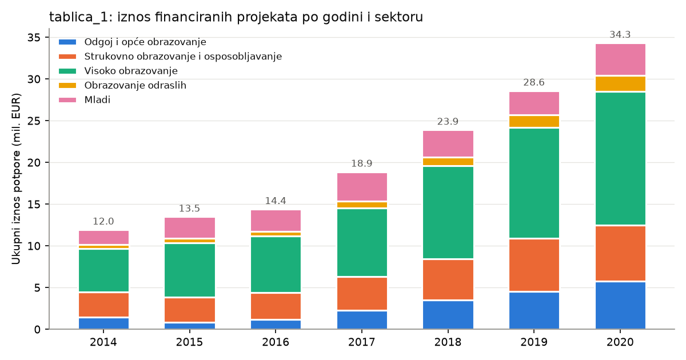
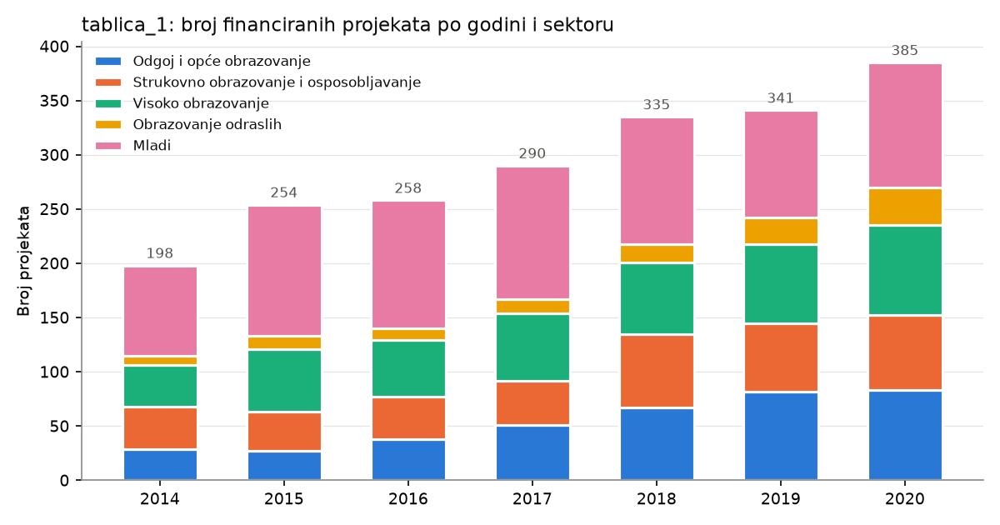
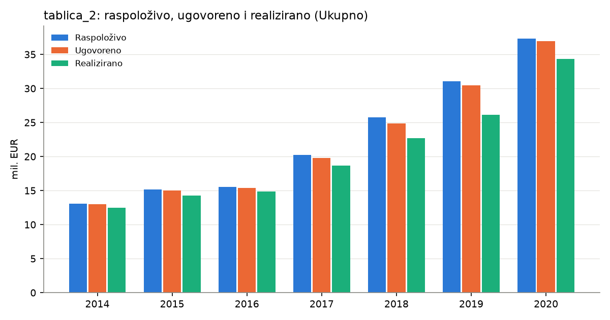
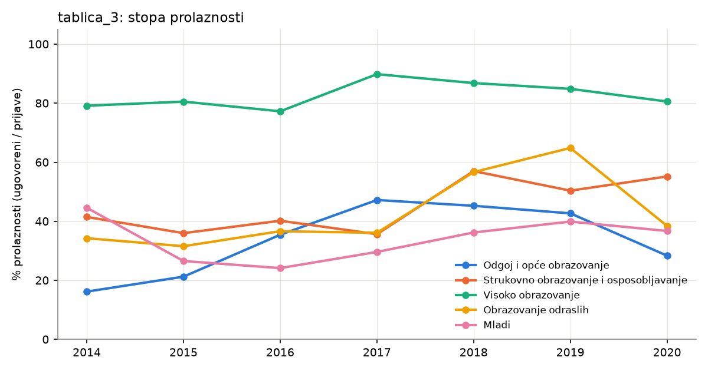
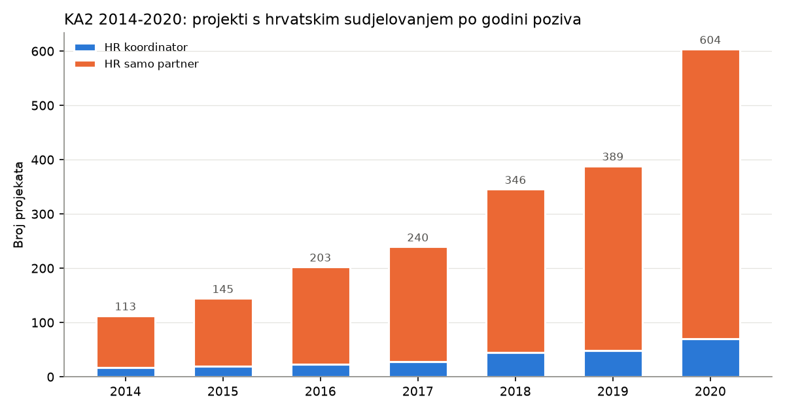

# EDA – Erasmus+ 2014–2020

Every number in this document is copied from the output of the scripts in `EDA/Scripts/` (run in the `datathon` conda env). Where something could not be determined from the data, it is marked as **open question** rather than explained.

All scripts take the period as an argument (`python Scripts/<script>.py 2014-2020`).

| Script | What it does |
|---|---|
| `01_inspect_structure.py` | Raw structure of the `tablica_*.xlsx` files (sheets, shapes, first/last rows) |
| `02_probe_2016_sheet.py` | Investigates the 16,384-column `2016` sheet in tablica_1 (2014-2020 only) |
| `03_peek_ka2_xls.py` | Sheets/dimensions/first rows of the large KA2 `.xls` |
| `04_project_list_non_project_rows.py` | Lists all title / section / subtotal rows in the project list |
| `05_parse_project_list.py` | Parses the project list into a tidy table → `Data/processed/project_list_2014-2020.csv` |
| `06_eda_project_list.py` | Descriptive stats + charts for the project list |
| `07_eda_finance_applications.py` | Tidies the finance and application tables, consistency checks, cross-check vs project list, charts |
| `08_load_cache_ka2.py` | Loads the KA2 `.xls` once and caches it → `Data/processed/ka2_2014-2020.parquet` |
| `09_eda_ka2.py` | EU-wide and Croatia-focused EDA of the KA2 file + chart |
| `10_column_inventory.py` | Column names, fill counts and example values for the *Columns* subsections |
| `11_adhoc_checks.py` | Checks first run as one-off commands: title texts and ID formats, KA2 field separators, full dump of the finance/application tables, placeholder summaries and `NA` cells, postal-code formats |
| `12_verify.py` | Bug checks: reconciles parsed projects with the sheets' own subtotals, looks for unparsed project rows, duplicate suffixed IDs, numbers lost in the long tables, repeated country codes in KA2 |
| `13_verify_ka2.py` | Recomputes every KA2 table a second, independent way (original `.xls` read with `xlrd`, plain-Python aggregation) and compares the full distributions with the pipeline: 0 mismatches |

Charts are saved in `EDA/Reports/figures/2014-2020/`.

---

## 1. The data files

| File | Content (as observed) | Shape |
|---|---|---|
| `tablica_1_popis_financiranih_projekata_erasmus_2014_2020_.xlsx` | List of funded projects. One sheet per year (2014–2020). Columns: *Projektni broj, Naziv korisnika, Adresa korisnika, Rok, Iznos financijske potpore* | 7 sheets, 260–501 rows each |
| `tablica_2_pregled-financijskih-rezultata-programa-erasmus-2014_2020.xlsx` | Financial overview: *Raspoloživo / Ugovoreno / Realizirano* + % rows, by year × 5 sectors + *Ukupno*. Updated 24.02.2025. | 48 × 9 raw |
| `tablica_3_broj-erasmus-zaprimljenih-i-odobrenih-projekata-2014_2020..xlsx` | Number of applications (*Prijave*), contracted (*Ugovoreni*) and *% prolaznosti* by year × sector. Updated 11.12.2023. | 29 × 9 raw |
| `ErasmusPlus_KA2_2014-2020_..._Projects_Overview_2026-10-27.xls` | EU-wide list of all KA2 ("Cooperation for innovation and the exchange of good practices") projects, every country. 1 sheet, header on row 0. | 24,823 projects × 249 columns |

The 5 sectors used throughout tablica_1/2/3: *Odgoj i opće obrazovanje, Strukovno obrazovanje i osposobljavanje, Visoko obrazovanje, Obrazovanje odraslih, Mladi*.

### 1.1 Data quality notes

- Each dataset section below (2, 3, 4, 6) starts with a **Columns and what they represent** subsection. Column names are given exactly as they appear in the files (inventory from `10_column_inventory.py`). Meanings are translations of the Croatian headers plus what is observed in the values.
- **Currency:** no column header in the tablica files states a currency. The only explicit hint is one amount stored as text, `180.147,00 EUR`, and the analysis assumes EUR throughout.

**tablica_1 is a formatted report, not a flat table.** Each year sheet has 5 blocks, one per sector. Each block starts with the title row *"FINANCIRANI PROJEKTI … U {year}. GODINI ZA PODRUČJE {sector}"*. Inside a block there are:

- section header rows (*Ključna aktivnost 1/2/3 …*, sub-actions such as *Razmjene mladih* or *Europska volonterska služba*, deadline rows *Rok …*);
- subtotal rows (*Ukupno*, *subtotal*, *… total*, *… sveukupno*);
- the project rows themselves.

Parsing it needed a script (`05_…`) that keeps only rows whose first cell is a Croatian project number.

- **Sheet `2016` has 16,384 columns.** All but the first 5 are junk: 5 rows (r211, r265, r300, r311, r325) repeat the text `Rok 26.4.2016.` across 16,357 columns. Only columns 0–4 hold data.
- **Project ID formats** (digits → 9):
  - `9999-9-HR99-KA999-999999`: 2,026 rows
  - `…_9` suffix: 12 rows
  - `…-KA999-{HE|SCH|ADU|YOU|VET}-999999`: 23 rows (all in 2020, KA226/KA227)
- **Deadline (*Rok*)** is stored in mixed forms: real Excel dates, text `d.m.yyyy.`, and text with stray spaces (`4. 3 .2015.`). All 2,061 parsed successfully.
- **Amount**: one value is text in Croatian number format, `180.147,00 EUR` (2017, `2017-3-HR01-KA205-046816`). It was converted to 180,147.
- **A placeholder row** in 2020 (`/ | / | / | 2020-10-01 | /`, under *KA3 Rok (3)*) was excluded. Its subtotal is 0.
- **Some subtotal rows are 0** (*subtotal 0*, *Ukupno 0*), e.g. in 2015 and 2019, under deadlines with no project rows.
- **The 2019 sheet contains deadline headers with 2018 dates** (*Rok 26.4.2018.*, *Rok 4.10.2018.*), each followed by an *Ukupno 0* row.
- **Duplicated project IDs**: 5 IDs appear twice (10 rows), all *Mladi*/KA105 in 2015–2016. Each appears once under one youth sub-action and once under *Mobilnost osoba koje rade s mladima*, with different amounts:

  | project_id | sub-action → amount | sub-action → amount |
  |---|---|---|
  | 2015-1-HR01-KA105-012685 | Razmjene mladih → 17,280 | Mobilnost osoba… → 21,340 |
  | 2015-1-HR01-KA105-012645 | Razmjene mladih → 27,540 | Mobilnost osoba… → 21,145 |
  | 2015-2-HR01-KA105-013302 | Razmjene mladih → 30,560 | Mobilnost osoba… → 9,670 |
  | 2016-2-HR01-KA105-022375 | Europska volonterska služba → 6,957 | Mobilnost osoba… → 1,375 |
  | 2016-2-HR01-KA105-022254 | Razmjene mladih → 17,938 | Mobilnost osoba… → 20,849 |

  Both rows were kept in all totals below. *Open question:* whether these are one project with two activity lines or a data entry error cannot be told from the file.
- **Beneficiary names are not standardised.** For example, *Sveučilište u Zagrebu* and *SVEUČILIŠTE U ZAGREBU* both occur. There are 973 distinct raw strings, and 877 after lowercasing and collapsing whitespace. Some generic names cover several organisations: *Tehnička škola* is 2 different schools (Požega and Slavonski Brod). *Gospodarska škola* has a single address (Čakovec).
- **Addresses**: a 5-digit postal code was found in 1,982 of 2,061 addresses. The rest have no postal code, have a 4-digit typo (`1000 Zagreb`, `3400 Požega`), or are street only (`Gundulićeva 23 a`).
- **The KA2 file uses no diacritics** in organisation names (`SVEUCILISTE U ZAGREBU`, `Osnovna skola Pantovcak`). Joining it to tablica_1 by name would therefore need normalisation.

---

## 2. tablica_1 – Funded projects (Croatian National Agency list)

**2,061 project rows, 2,056 unique project IDs, total 145,598,135.26 EUR.**

### Columns and what they represent

*One sheet per year 2014–2020; the same 5 headers in every sheet.*

| Column | Meaning | Observed values |
|---|---|---|
| `Projektni broj` | Project number | `YYYY-R-HR01-KAxxx-NNNNNN` (e.g. `2014-1-HR01-KA101-000430`): call year, round digit, `HR01`, key-action code, sequence number. Variants: a `_1` suffix (12 rows) and a field code (`-HE-`, `-SCH-`, `-VET-`, `-ADU-`, `-YOU-`, 23 rows in 2020) |
| `Naziv korisnika` | Beneficiary name | Free text; spelling and letter case vary for the same organisation |
| `Adresa korisnika` | Beneficiary address | Free text, usually street, postal code and city in one cell (format varies) |
| `Rok` | Deadline | A date within the call year (e.g. `24.3.2014.`). Stored as Excel dates or as text. The file doesn't say which deadline this is |
| `Iznos financijske potpore` | Amount of financial support | Numeric (one text value `180.147,00 EUR`) |

These columns are **not** in the sheet; the parser derives them from the layout. The sector comes from each block's title row (*…ZA PODRUČJE …*), and the key action / sub-action from section header rows (*Ključna aktivnost …*, *Razmjene mladih*, …).

#### Processed dataset: `Data/processed/project_list_2014-2020.csv` (+ `_enriched.csv`)

**What it is:** tablica_1 turned into a flat table with **one row per funded project** (2,061 rows, 2,056 unique `Projektni broj`; 5 IDs appear twice (see 1.1)). It is created by `05_parse_project_list.py 2014-2020`. The `_enriched` version adds normalised names and location; it is created by `06_eda_project_list.py 2014-2020`.

**Column headers are in Croatian.** The names are defined in `Scripts/nazivi_stupaca.py`; the scripts translate them back to short internal names when they read the file. CSV files are saved as UTF-8 with BOM, so Excel shows č, ć, š, ž and đ correctly.

**How it was built (step by step):**

1. Every year sheet is read without assuming where the header is. Only the first 8 columns are used (the `2016` sheet has ~16,000 junk columns).
2. The sheet is read top to bottom while the script remembers its current context:
   - the **sector**, from the last block title (*…ZA PODRUČJE …*, matched by keyword to the six sector names);
   - the last ***Ključna aktivnost …*** header;
   - the last **sub-action** header (a text-only row such as *Razmjene mladih* or *Mala partnerstva (KA210)*).
3. Each column-header row (*Projektni broj …*) sets which column holds which field. This works by matching words in the header (`naziv` → beneficiary, `adresa` → address, `mjesto` → city, `poštanski` → postal code, `rok` → deadline, `iznos` → amount), so that header variants between years are handled.
4. A row becomes a project only if its first cell matches the project-ID pattern `YYYY-R-HR01-KAxxx[-FIELD]-number`. The parts of the ID are split into `Natječajna godina`, `Krug natječaja`, `Šifra ključne aktivnosti`, `Šifra područja` and `Redni broj projekta`. The hyphen before the number is optional; IDs without it are flagged in `Neispravan projektni broj`.
5. All other rows are **not kept as rows**:
   - titles and column-header rows;
   - section headers (used only as context, step 2);
   - deadline rows (`Rok …`);
   - subtotals (`Ukupno`, `subtotal`, `… total`, `… sveukupno`);
   - update-date rows.
- the placeholder row `/ | / | / | 2020-10-01 | /` (2020, KA3)
6. Value cleaning:
   - surrounding whitespace is removed from all text;
   - deadlines are converted to dates, from Excel dates or from text `d.m.yyyy.` (spaces inside removed);
   - one amount stored as text in Croatian number format (`180.147,00 EUR`) is converted to 180147.0.
7. `Ključna aktivnost` = the first three characters of `Šifra ključne aktivnosti` (`KA1` / `KA2` / `KA3`).
8. Enriched file only:
   - `Naziv korisnika (normaliziran)` = the name lowercased with whitespace collapsed;
   - location parsed from the address text: `Poštanski broj (očišćen)` is the last 5-digit number in the address (`10 000` is accepted), and `Mjesto (očišćeno)` is the text after it, in title case.

**Deliberately NOT changed:**

- names, addresses and city spellings are not corrected or merged;
- duplicate IDs are kept;
- amounts are not reconciled against the subtotal rows in the sheet.

**Columns** (fill counts out of 2,061 rows):

| Column | Meaning | Filled |
|---|---|---|
| `List`, `Redak` | Sheet name and row number in the Excel file (for tracing back) | all |
| `Sektor` | Sector from the block title | all |
| `Zaglavlje ključne aktivnosti` | Text of the last *Ključna aktivnost …* header above the row | 2,061 |
| `Zaglavlje podaktivnosti` | Text of the last sub-action header above the row | 779 |
| `Projektni broj` | Project number as written (whitespace stripped) | all |
| `Natječajna godina`, `Krug natječaja`, `Šifra ključne aktivnosti`, `Šifra područja`, `Redni broj projekta` | Parts of the project ID | all; `Šifra područja` 23 |
| `Naziv korisnika`, `Adresa korisnika` | As written in the sheet | all; `Adresa korisnika` 2,061 |
| `Mjesto`, `Poštanski broj` | *Mjesto* / *Poštanski broj* as written | 0 (column does not exist in this period) / 0 (column does not exist in this period) |
| `Rok` | *Rok* as a date | 2,061 |
| `Iznos (EUR)` | Approved amount (currency assumed EUR) | all |
| `Ključna aktivnost` | `KA1` / `KA2` / `KA3` from `Šifra ključne aktivnosti` | all |
| `Neispravan projektni broj` | True if the ID lacks the hyphen before the number | 0 True |
| `Naziv korisnika (normaliziran)` *(enriched)* | Lowercased, whitespace-collapsed name | all |
| `Poštanski broj (očišćen)`, `Mjesto (očišćeno)` *(enriched)* | Cleaned location (see step 8) | 1,982 / 1,977 |

### 2.1 Grant amount distribution (EUR)

| count | mean | std | min | 25% | median | 75% | max |
|---:|---:|---:|---:|---:|---:|---:|---:|
| 2,061 | 70,644 | 191,049 | 1,375 | 15,360 | 23,935 | 59,103 | 3,888,540 |

The mean is about 3× the median. The distribution is strongly right-skewed (see `figures/2014-2020/projects_amount_distribution.png`).

### 2.2 By call year

| Year | Projects | Total EUR | Mean | Median |
|---:|---:|---:|---:|---:|
| 2014 | 198 | 11,950,515 | 60,356 | 20,050 |
| 2015 | 254 | 13,496,196 | 53,135 | 18,998 |
| 2016 | 258 | 14,410,448 | 55,854 | 19,360 |
| 2017 | 290 | 18,885,764 | 65,123 | 23,960 |
| 2018 | 335 | 23,912,788 | 71,381 | 25,110 |
| 2019 | 341 | 28,608,338 | 83,895 | 29,858 |
| 2020 | 385 | 34,334,086 | 89,179 | 28,729 |

Both the number of projects and the total amount rise every year from 2014 to 2020.

### 2.3 By sector

| Sector | Projects | Total EUR | Mean | Median |
|---|---:|---:|---:|---:|
| Odgoj i opće obrazovanje | 377 | 19,625,746 | 52,058 | 20,579 |
| Strukovno obrazovanje i osposobljavanje | 355 | 31,327,601 | 88,247 | 64,924 |
| Visoko obrazovanje | 432 | 67,166,985 | 155,479 | 41,004 |
| Obrazovanje odraslih | 121 | 6,755,453 | 55,830 | 12,222 |
| Mladi | 776 | 20,722,350 | 26,704 | 19,182 |

*Mladi* has the most projects (776), but *Visoko obrazovanje* has the largest total (67.2 M EUR, 46% of the tablica_1 total).

Sector × year, total EUR:

| Sector | 2014 | 2015 | 2016 | 2017 | 2018 | 2019 | 2020 |
|---|---:|---:|---:|---:|---:|---:|---:|
| Odgoj i opće obr. | 1,453,233 | 832,514 | 1,164,334 | 2,320,343 | 3,521,618 | 4,576,888 | 5,756,816 |
| Strukovno | 3,049,674 | 3,002,362 | 3,277,755 | 3,981,582 | 4,932,635 | 6,338,899 | 6,744,694 |
| Visoko | 5,178,468 | 6,523,340 | 6,737,018 | 8,269,824 | 11,151,044 | 13,306,275 | 16,001,016 |
| Odrasli | 507,539 | 547,369 | 526,171 | 770,640 | 1,009,566 | 1,474,522 | 1,919,646 |
| Mladi | 1,761,601 | 2,590,611 | 2,705,170 | 3,543,375 | 3,297,925 | 2,911,754 | 3,911,914 |

Sector × year, project counts:

| Sector | 2014 | 2015 | 2016 | 2017 | 2018 | 2019 | 2020 |
|---|---:|---:|---:|---:|---:|---:|---:|
| Odgoj i opće obr. | 29 | 27 | 38 | 51 | 67 | 82 | 83 |
| Strukovno | 39 | 36 | 39 | 41 | 68 | 63 | 69 |
| Visoko | 38 | 58 | 52 | 62 | 66 | 73 | 83 |
| Odrasli | 9 | 12 | 11 | 13 | 17 | 24 | 35 |
| Mladi | 83 | 121 | 118 | 123 | 117 | 99 | 115 |

*Mladi* is the only sector without steady growth: its project count peaks in 2017 (123) and its amount in 2020.

### 2.4 By key action and KA code

| Key action (section header) | Projects | Total EUR | Mean | Median |
|---|---:|---:|---:|---:|
| KA1 – Mobilnost u svrhu učenja | 1,754 | 104,586,125 | 59,627 | 22,075 |
| KA2 – Strateška partnerstva | 242 | 40,153,241 | 165,922 | 164,954 |
| KA3 – Potpora reformi politika | 65 | 858,769 | 13,212 | 11,300 |

KA codes (from the project ID). Each code maps to one sector, except KA200, KA226 and KA227, which appear in several:

| KA code | Sector(s) | Projects | Total EUR | Median |
|---|---|---:|---:|---:|
| KA103 | Visoko | 284 | 48,610,640 | 32,506 |
| KA102 | Strukovno | 290 | 19,288,549 | 52,924 |
| KA105 | Mladi | 632 | 12,795,823 | 19,316 |
| KA107 | Visoko | 116 | 11,213,608 | 44,455 |
| KA229 | Odgoj i opće | 45 | 6,317,892 | 143,450 |
| KA202 | Strukovno | 32 | 6,234,530 | 207,001 |
| KA201 | Odgoj i opće | 34 | 6,106,344 | 165,148 |
| KA203 | Visoko | 22 | 5,370,546 | 226,558 |
| KA116 | Strukovno | 31 | 5,346,916 | 129,862 |
| KA204 | Odrasli | 31 | 5,261,833 | 177,697 |
| KA205 | Mladi | 33 | 5,153,306 | 164,986 |
| KA101 | Odgoj i opće | 274 | 5,130,694 | 17,780 |
| KA226 | Odgoj 2, Strukovno 2, Visoko 9 | 13 | 2,541,084 | 203,672 |
| KA227 | Odgoj 2, Odrasli 4, Mladi 4 | 10 | 1,327,054 | 130,036 |
| KA219 | Odgoj i opće | 19 | 1,132,601 | 34,710 |
| KA104 | Odrasli | 85 | 920,702 | 8,360 |
| KA347 | Mladi | 65 | 858,769 | 11,300 |
| KA125 | Mladi | 38 | 774,635 | 17,130 |
| KA200 | Odgoj 1, Visoko 1, Odrasli 1 | 3 | 708,051 | 239,855 |
| KA135 | Mladi | 4 | 504,558 | 110,612 |

KA226 and KA227 occur only in 2020. They are the only codes carrying a field suffix (`-HE`, `-SCH`, `-VET`, `-ADU`, `-YOU`).

### 2.5 Call round (digit after the year in the project ID)

| Round | 2014 | 2015 | 2016 | 2017 | 2018 | 2019 | 2020 |
|---:|---:|---:|---:|---:|---:|---:|---:|
| 1 | 163 | 171 | 170 | 206 | 261 | 287 | 330 |
| 2 | 35 | 46 | 50 | 37 | 48 | 27 | 39 |
| 3 | 0 | 37 | 38 | 47 | 26 | 27 | 16 |

### 2.6 Largest and smallest grants

All 10 largest grants are KA103 (higher-education mobility) awarded to universities. Seven of them go to Sveučilište u Zagrebu, one per year, ranging from 2,094,013 (2015) to 3,888,540 (2020). The others are Split 2020 (1,571,992), Split 2019 (1,402,120) and Osijek 2020 (1,205,526).

The 10 smallest grants range from 1,375 to 2,411 EUR. They are mostly KA104 (adult education) and KA105 (youth). The smallest, 1,375, is one of the duplicated-ID rows above.

### 2.7 Beneficiaries (lowercased + whitespace-normalised names)

- 877 distinct beneficiaries.
- 591 of the 973 raw name strings have exactly 1 project.
- The **top 10 beneficiaries by amount receive 38.5%** of the total.

| Top by amount | Projects | Total EUR |
|---|---:|---:|
| sveučilište u zagrebu | 17 | 23,406,457 |
| sveučilište u splitu | 17 | 9,357,385 |
| sveučilište j. j. strossmayera u osijeku | 15 | 5,960,586 |
| sveučilište u rijeci | 15 | 5,600,759 |
| sveučilište u zadru | 13 | 2,931,037 |
| gospodarska škola (Čakovec) | 9 | 2,716,442 |
| sveučilište u dubrovniku | 14 | 1,851,131 |
| škola za cestovni promet (Zagreb) | 10 | 1,597,260 |
| sveučilište jurja dobrile u puli | 13 | 1,378,192 |
| tehničko veleučilište u zagrebu | 11 | 1,213,510 |

| Top by number of projects | Projects | Total EUR |
|---|---:|---:|
| hrvatska škola outward bound (hsob) | 23 | 308,291 |
| ocean znanja u republici hrvatskoj | 19 | 423,026 |
| sveučilište u zagrebu | 17 | 23,406,457 |
| sveučilište u splitu | 17 | 9,357,385 |
| civilna, edukativna i transparentna platforma | 17 | 358,960 |

The most frequent beneficiaries by count are mostly youth organisations with small grants. The largest by amount are universities.

### 2.8 Location (parsed from the address text)

| City | Projects | Total EUR |
|---|---:|---:|
| Zagreb | 646 | 56,730,841 |
| Split | 117 | 13,734,669 |
| Rijeka | 101 | 10,299,810 |
| Osijek | 89 | 10,427,233 |
| Slavonski Brod | 52 | 2,882,731 |
| Karlovac | 51 | 1,264,668 |
| Čakovec | 42 | 5,499,529 |
| Šibenik | 35 | 1,974,086 |
| Pula | 34 | 2,066,202 |
| Dubrovnik | 34 | 3,292,372 |

By postal-code prefix, `10` (Zagreb area) has 736 projects and 59.7 M EUR, i.e. **about 41% of the total amount**. The prefix shares are based on the 1,982 addresses with a parsed postal code.

---

## 3. tablica_2 – Financial overview (EUR)

### Columns and what they represent

*One sheet.*

| Column | Meaning |
|---|---|
| `Natječajna godina` | Call year (`2014.`–`2020.`, plus a `Sveukupno` = grand total block). Only filled on the first row of each year block |
| *(column 1, unnamed)* | Empty |
| `Stavka` | Line item. Values below |
| `Odgoj i opće obrazovanje` | Sector: school / general education |
| `Strukovno obrazovanje i osposobljavanje` | Sector: vocational education and training |
| `Visoko obrazovanje` | Sector: higher education |
| `Obrazovanje odraslih` | Sector: adult education |
| `Mladi` | Sector: youth |
| `Ukupno` | Total across sectors (verified: equals the sum of the 5 sector columns) |

`Stavka` values:

| Value | Meaning |
|---|---|
| `Raspoloživo` | Available funds |
| `Ugovoreno` | Contracted funds |
| `Realizirano` | Realised funds |
| `% ugovorenih sredstava` | Share contracted. Checked against the figures: = Ugovoreno ÷ Raspoloživo |
| `% realiziranih sredstava` | Share realised. Checked against the figures: = Realizirano ÷ Ugovoreno. The *Sveukupno* row is labelled with an asterisk, and the sheet has no matching footnote |

#### Processed dataset: `Data/processed/finance_2014-2020_long.csv`

**What it is:** tablica_2 reshaped from its printed wide layout into **long format**: one row per *year × item × sector* (240 rows = 8 year labels (2014–2020 + *Sveukupno*) × 5 items × 6 sector columns (5 sectors + *Ukupno*)). It is created by `07_eda_finance_applications.py 2014-2020`. Long format makes it easy to filter and pivot (e.g. *Ugovoreno* by sector) and to join with the project list on `Natječajna godina` + `Sektor`.

**Column headers are in Croatian.** The names are defined in `Scripts/nazivi_stupaca.py`; the scripts translate them back to short internal names when they read the file. CSV files are saved as UTF-8 with BOM, so Excel shows č, ć, š, ž and đ correctly.

**How it was built:**

1. The header row is found by looking for `Natječajna godina` in column 0.
2. Sector columns are found by matching header text to the sector names, with asterisks removed (`Sport*` → `Sport`). The total column is the one whose header starts with `Ukupno`; it is renamed `Ukupno`.
3. The item column is the column just left of the first sector column. Rows with no item label (titles, footnotes, update date) are dropped.
4. The year label appears only on the first row of each block, so it is filled down. Trailing `.` and line breaks are removed (`2021.\n` → `2021`). Total rows keep their label (e.g. `Sveukupno`).
5. Asterisks (footnote markers) are removed from item labels in `Stavka`; the original label is kept in `Stavka (izvorno)`.
6. The table is reshaped from wide to long, and `Vrijednost` is converted to a number.

**Values:**

- Numbers are as in the source.
- % rows are stored as fractions (0–1), not recomputed.
- Empty source cells stay as empty `Vrijednost` rows: 0 empty cells.

**Columns:**

| Column | Meaning |
|---|---|
| `Natječajna godina` | Call year as text, or the total-row label |
| `Ključna aktivnost` | always `all` (the finance table has no KA split) |
| `Stavka` | `Raspoloživo`, `Ugovoreno`, `Realizirano`, `% ugovorenih sredstava`, `% realiziranih sredstava` |
| `Stavka (izvorno)` | Item label exactly as written (with `*` / `**`) |
| `Sektor` | Sector name, or `Ukupno` for the total column |
| `Vrijednost` | The number in that cell |

Internal checks:

- The 5 sector columns sum exactly to *Ukupno* (max abs diff 0.00).
- The *% realiziranih sredstava* row exists per year. For *Sveukupno* it is labelled *% realiziranih sredstava\** (with an asterisk). No footnote explaining the asterisk was found in column 0 of the sheet.

| Year | Raspoloživo | Ugovoreno | Realizirano | % ugovoreno | % realizirano |
|---|---:|---:|---:|---:|---:|
| 2014 | 13,109,777 | 12,990,229 | 12,510,343 | 99.1% | 96.3% |
| 2015 | 15,194,136 | 15,044,310 | 14,301,551 | 99.0% | 95.1% |
| 2016 | 15,576,469 | 15,395,456 | 14,895,642 | 98.8% | 96.8% |
| 2017 | 20,285,766 | 19,796,712 | 18,693,905 | 97.6% | 94.4% |
| 2018 | 25,802,624 | 24,908,333 | 22,735,196 | 96.5% | 91.3% |
| 2019 | 31,094,474 | 30,469,506 | 26,157,911 | 98.0% | 85.8% |
| 2020 | 37,357,502 | 36,964,285 | 34,321,474 | 98.9% | 92.9% |
| **Sveukupno** | **158,420,748** | **155,568,831** | **143,616,023** | **98.2%** | **92.3%\*** |

**% realizirano by sector:**

| Year | Odgoj | Strukovno | Visoko | Odrasli | Mladi |
|---|---:|---:|---:|---:|---:|
| 2014 | 95.7% | 98.3% | 96.5% | 95.6% | 94.0% |
| 2015 | 97.0% | 98.6% | 93.6% | 99.4% | 91.8% |
| 2016 | 98.1% | 98.9% | 95.7% | 98.2% | 95.5% |
| 2017 | 98.0% | 96.3% | 92.5% | 98.4% | 92.5% |
| 2018 | 91.7% | 98.5% | 86.4% | 91.5% | 95.3% |
| 2019 | 92.0% | 93.7% | **76.5%** | 92.6% | 93.5% |
| 2020 | 97.5% | 96.2% | 87.5% | 95.7% | 94.3% |
| Total\* | 95.3% | 96.8% | 87.9% | 95.2% | 93.9% |

- The lowest realisation rate in the table is *Visoko obrazovanje* 2019 (76.5%).
- *Visoko obrazovanje* has the lowest overall realisation (87.9%).
- Contracting rates (% ugovoreno) are 93.2%–100% in every cell. The lowest is *Visoko* 2018 at 93.2%.

---

## 4. tablica_3 – Applications vs contracted projects

### Columns and what they represent

*One sheet.*

| Column | Meaning |
|---|---|
| `Natječajna godina` | Call year (`2014.`–`2020.`, plus `Ukupno prema sektorskom području` = total by sector) |
| *(item column, unnamed)* | One of three values (below) |
| The 5 sector columns | As in tablica_2 |
| `Ukupno prema natječajnoj godini` | Total for the call year (sum of sectors) |

Item values:

| Value | Meaning |
|---|---|
| `Prijave` | Applications received |
| `Ugovoreni` | Contracted projects |
| `% prolaznosti` | Success rate. Checked against the figures: = Ugovoreni ÷ Prijave |

#### Processed dataset: `Data/processed/applications_2014-2020_long.csv`

**What it is:** tablica_3 reshaped from its printed wide layout into **long format**: one row per *year × item × sector* (144 rows = 8 year labels (2014–2020 + total) × 3 items × 6 sector columns). It is created by `07_eda_finance_applications.py 2014-2020`. Long format makes it easy to filter and pivot (e.g. *Ugovoreni* by sector) and to join with the project list on `Natječajna godina` + `Sektor`.

**Column headers are in Croatian.** The names are defined in `Scripts/nazivi_stupaca.py`; the scripts translate them back to short internal names when they read the file. CSV files are saved as UTF-8 with BOM, so Excel shows č, ć, š, ž and đ correctly.

**How it was built:**

1. The header row is found by looking for `Natječajna godina` in column 0.
2. Sector columns are found by matching header text to the sector names, with asterisks removed (`Sport*` → `Sport`). The total column is the one whose header starts with `Ukupno`; it is renamed `Ukupno`.
3. The item column is the column just left of the first sector column. Rows with no item label (titles, footnotes, update date) are dropped.
4. The year label appears only on the first row of each block, so it is filled down. Trailing `.` and line breaks are removed (`2021.\n` → `2021`). Total rows keep their label (e.g. `Sveukupno`).
5. Asterisks (footnote markers) are removed from item labels in `Stavka`; the original label is kept in `Stavka (izvorno)`.
6. The table is reshaped from wide to long, and `Vrijednost` is converted to a number.

**Values:**

- Numbers are as in the source.
- % rows are stored as fractions (0–1), not recomputed.
- Empty source cells stay as empty `Vrijednost` rows: 0 empty cells.

**Columns:**

| Column | Meaning |
|---|---|
| `Natječajna godina` | Call year as text, or the total-row label |
| `Ključna aktivnost` | always `all` |
| `Stavka` | `Prijave`, `Ugovoreni`, `% prolaznosti` |
| `Stavka (izvorno)` | Item label exactly as written (with `*` / `**`) |
| `Sektor` | Sector name, or `Ukupno` for the total column |
| `Vrijednost` | The number in that cell |

Internal checks: sector columns sum exactly to *Ukupno*, and the yearly rows sum exactly to *Ukupno prema sektorskom području* (max abs diff 0.00 for both).

| Year | Prijave | Ugovoreni | % prolaznosti |
|---|---:|---:|---:|
| 2014 | 652 | 250 | 38.3% |
| 2015 | 785 | 252 | 32.1% |
| 2016 | 783 | 256 | 32.7% |
| 2017 | 743 | 290 | 39.0% |
| 2018 | 698 | 336 | 48.1% |
| 2019 | 688 | 341 | 49.6% |
| 2020 | 928 | 386 | 41.6% |
| **Total** | **5,277** | **2,111** | **40.0%** |

By sector, 2014–2020 totals:

| Sector | Prijave | Ugovoreni | % prolaznosti |
|---|---:|---:|---:|
| Odgoj i opće obrazovanje | 1,160 | 379 | 32.7% |
| Strukovno obrazovanje i osposobljavanje | 777 | 356 | 45.8% |
| Visoko obrazovanje | 520 | 431 | **82.9%** |
| Obrazovanje odraslih | 297 | 124 | 41.8% |
| Mladi | 2,523 | 821 | 32.5% |

- *Visoko obrazovanje* has a success rate of 77–90% in every year. All other sectors stay between 16% and 65%.
- *Mladi* has the most applications (2,523, 48% of all), but they fall from 480 (2016) to 248 (2019).
- *Odgoj i opće obrazovanje* applications rise from 108 (2017) to 296 (2020). Its success rate in 2020 (28.4%) is the lowest since 2015.
- *Obrazovanje odraslih* applications jump from 37 (2019) to 91 (2020). Its success rate falls from 64.9% to 38.5%.

---

## 5. Cross-check between tablica_1, tablica_2 and tablica_3

**Parser check first (`12_verify.py`).** The parsed tablica_1 projects were reconciled against all 182 *Ukupno*/*subtotal* rows printed in the sheets themselves.

- 177 match exactly.
- The 5 that don't (all 2015) are layout quirks of the sheet:
  - 3 higher-level totals repeat an earlier subtotal;
  - one subtotal is printed as `0` (r317), and the correct value, 238,005, appears on the next line.
- No project-like row is left unparsed, except the `/` placeholder.

So tablica_1 is parsed completely, and **the gaps below are differences between the published tables, not parsing errors.**

**Project counts.** tablica_1 count minus tablica_3 *Ugovoreni*:

| Year | Odgoj | Strukovno | Visoko | Odrasli | Mladi |
|---|---:|---:|---:|---:|---:|
| 2014 | 0 | 0 | 0 | −3 | **−49** |
| 2015 | 0 | 0 | 0 | 0 | +2 |
| 2016 | −1 | 0 | +1 | 0 | +2 |
| 2017 | 0 | 0 | 0 | 0 | 0 |
| 2018 | 0 | −1 | 0 | 0 | 0 |
| 2019 | 0 | 0 | 0 | 0 | 0 |
| 2020 | −1 | 0 | 0 | 0 | 0 |

Counts agree almost exactly. The exception is 2014: tablica_1 lists 49 fewer *Mladi* projects and 3 fewer *Obrazovanje odraslih* projects than tablica_3 reports.

**Amounts.** tablica_1 sum divided by tablica_2 *Ugovoreno*:

| Year | Odgoj | Strukovno | Visoko | Odrasli | Mladi |
|---|---:|---:|---:|---:|---:|
| 2014 | 0.902 | 1.000 | 0.992 | 0.906 | 0.692 |
| 2015 | **0.347** | 1.000 | 1.003 | 1.000 | 1.000 |
| 2016 | **0.548** | 1.005 | 0.993 | 1.003 | 1.001 |
| 2017 | **0.677** | 1.008 | 0.994 | 1.000 | 1.062 |
| 2018 | **0.675** | 1.011 | 1.061 | 1.004 | 1.000 |
| 2019 | **0.700** | 1.017 | 1.016 | 0.996 | 0.935 |
| 2020 | **0.584** | 1.013 | 1.092 | 1.003 | 1.008 |

- For most sector-years the tablica_1 amounts match tablica_2 *Ugovoreno* within about ±2%.
- **For *Odgoj i opće obrazovanje* the tablica_1 sum is only 35–90% of *Ugovoreno*, even though project counts match.** *Open question:* the files do not say why. The amounts listed in tablica_1 for school-sector projects are lower than the contracted totals in tablica_2.
- *Mladi* 2014 (0.692) is consistent with the 49 missing projects.
- *Visoko* 2020 (1.092) and 2018 (1.061) exceed *Ugovoreno*. *Open question.*

**Recommendation:** use tablica_2 for budget totals and tablica_1 for project-level and beneficiary-level analysis, keeping the gaps above in mind.

---

## 6. KA2 project overview (EU-wide, 2014–2020)

### Columns and what they represent

*249 columns.*

21 project and coordinator columns:

| Column | Meaning / observed values |
|---|---|
| `Programme` | Always `Erasmus+` |
| `Key Action` | Always `Cooperation for innovation and the exchange of good practices` |
| `Action Type` | Sub-action, 17 distinct (e.g. *School Exchange Partnerships*, *Strategic Partnerships for adult education*, *Capacity Building in higher education*) |
| `Call year` | 2014–2020 |
| `Project Identifier` | Unique project code, e.g. `554175-EPP-1-2014-1-UK-EPPKA2-CBY-ACPALA` |
| `Project Title` | Free text |
| `Topics` | One or more topics separated by `; ` (59 distinct topics); 6.8% empty |
| `Project Summary` | Free text description. Never empty, but 110 are placeholders such as `N/A` or `-` |
| `Project Status` | `finalized` / `terminated` / `ongoing` |
| `EU Grant award in euros (This amount represents the grant awarded after the selection stage and is indicative. Please note that any changes made during or after the project's lifetime will not be reflected here.)` | EU grant for the **whole project**, in EUR (the header says it is indicative) |
| `Is Good Practice` | `Yes` / `No` flag. The file does not define the criteria |
| `Project Website` | URL; 98.6% empty |
| `Results Available` | `Yes` / `No` |
| `Results Platform Project Card` | URL of the project page on erasmus-plus.ec.europa.eu |
| `Participating countries` | Comma-separated 2-letter country codes (e.g. `SK,IN`). For HR, verified to match the coordinator/partner country columns exactly |
| `Coordinating organisation name` | Coordinator's name; usually upper case and without diacritics |
| `Coordinating organisation type` | 83 distinct (e.g. *Higher education institution (tertiary level)*, *Non-governmental organisation/association/social enterprise*) |
| `Coordinator's address` | Street, postal code, city |
| `Coordinator's region` | Region name (e.g. *Noord-Holland*, *Grad Zagreb*); 13.5% empty |
| `Coordinator's country` | 2-letter code (84 distinct). `NA` = Namibia |
| `Coordinator's website` | 97.9% empty |

Partner columns: 38 partners × 6 columns, named `Partner N <field>` with N = 1–38:

| Field | Meaning |
|---|---|
| `name` | Partner organisation name |
| `organisation type` | Same categories as the coordinator type |
| `address` | Partner address |
| `region` | Region; for non-European partners it holds the country name (e.g. *India*, *Brazil*) |
| `country` | 2-letter country code |
| `website` | Partner website |

A partner slot is empty when the project has fewer partners; the median project has 4 partners.

#### Processed dataset: `Data/processed/ka2_2014-2020.parquet`

**What it is:** an exact copy of the EU-wide KA2 `.xls` (24,823 rows × 249 columns), saved in Parquet format (62.6 MB instead of 280.4 MB). It is created by `08_load_cache_ka2.py 2014-2020`. The only reason for it is speed: later scripts load the Parquet file instead of re-reading the large Excel file.

**Column headers:** the original English headers of the EU file, unchanged. The other processed datasets use Croatian headers.

**How it was built:**

1. The single sheet is read with `xlrd`, using row 0 as the header.
2. **Every value is read as text** (`dtype=str`), so nothing is silently converted; for example, project identifiers keep their exact form.
3. **Only empty cells count as missing** (`keep_default_na=False`). pandas would otherwise turn strings like `NA`, `N/A` or `None` into missing values. Here 7 partner-country cells hold `NA` (Namibia), and the summary placeholders (`NA`, `N/A`, …) are kept as text.
4. Surrounding whitespace is removed from column names. No rows or columns are removed, and no values are changed.

**Not stored in the file:** numbers and derived fields. `09_eda_ka2.py` computes these each time it runs:

- the grant as a number;
- the call year as a number;
- the list of participating countries;
- the number of partners and countries;
- the HR coordinator / participant flags.

**Columns:** the same as the original file (see the table above). To use the grant column, convert it to a number first, e.g. `pd.to_numeric(df[grant_col])`.

### 6.1 Structure and quality

- 24,823 rows, 24,823 unique *Project Identifier*.
- The grant column and call year are numeric in all rows.
- *Programme* is always `Erasmus+`. *Key Action* is always `Cooperation for innovation and the exchange of good practices`.
- Wide layout: 21 project/coordinator columns, then up to 38 partners × 6 fields (name, organisation type, address, region, country, website).
- Missing values:
  - *Project Website*: 98.6%
  - *Coordinator's website*: 97.9%
  - *Coordinator's region*: 13.5%
  - *Topics*: 6.8%
  - all others: ~0%
- *Project Summary* is never empty, but 110 summaries are placeholders of ≤5 characters (`N/A` 20, `-` 20, `NA` 13, `/` 9, `n/a` 7, …).
- The file is loaded so that only empty cells count as missing. Otherwise pandas would read the country code `NA` (Namibia) as missing.
  - **In country columns, `NA` = Namibia.** This was verified for all 7 cells (all partner countries) by `11_adhoc_checks.py`, check 4: every one has region `Namibia`, and the organisations are e.g. *YOUNG AFRICA (NAMIBIA) TRUST* (Walvis Bay) and *UNIVERSITY OF NAMIBIA* (Windhoek). With this, every named partner and coordinator has a country code.
  - **In *Project Summary*, `NA` (13 cells) is a placeholder meaning "no summary"**, like `N/A` and `-`. Treat it as missing when analysing summary text.
- *Project Status*: finalized 23,996 / terminated 676 / ongoing 151.
- *Is Good Practice* = Yes: 5,799. *Results Available* = Yes: 19,573.
- The grant column header says the amount is "awarded after the selection stage and is indicative". 25 projects have a grant of 0.
- Organisation names sometimes have leading or trailing spaces. `09_eda_ka2.py` strips them so the same name isn't counted twice; this was found by `13_verify_ka2.py`.
- One HR partner's *name* is only a number, `13766250458`: project `2018-1-LT01-KA229-047039`, Partner 1, a pre-primary school at *Tršćanska 29, 21 0000, Split*.
  - The name is not given in the file.
  - The address has the same 6-digit postal code `21 0000` as *Dječji vrtić Cvit Mediterana* in tablica_7. Whether it is the same organisation can't be confirmed from the data.

### 6.2 Overview

| Grant (EUR) | count | mean | std | min | 25% | median | 75% | max |
|---|---:|---:|---:|---:|---:|---:|---:|---:|
| | 24,823 | 200,698 | 287,022 | 0 | 88,503 | 143,428 | 230,323 | 5,000,000 |

| Call year | Projects | Total EUR | Median |
|---:|---:|---:|---:|
| 2014 | 1,830 | 344,887,350 | 170,906 |
| 2015 | 2,198 | 487,214,328 | 165,340 |
| 2016 | 2,656 | 537,584,880 | 133,639 |
| 2017 | 3,177 | 636,218,843 | 134,195 |
| 2018 | 3,995 | 721,916,740 | 126,479 |
| 2019 | 4,726 | 939,313,037 | 132,639 |
| 2020 | 6,241 | 1,314,780,614 | 156,782 |

Partners per project: mean 4.62, median 4, max 37. Countries per project: mean 4.61, median 5, max 32.

**Action types:**

- The most projects are in *School Exchange Partnerships* (5,767).
- The largest total is *Capacity Building in higher education* (804.8 M EUR, 904 projects).
- The largest per-project grant is in *European Universities* (41 projects, median 5,000,000).

Topics: 59 distinct. The most common are *New innovative curricula/educational methods* (7,526) and *ICT – new technologies – digital competences* (6,428).

Coordinator country: the top 5 are DE 2,817 (11.3%), ES 2,402, FR 2,029, IT 1,897 and PL 1,801. **HR ranks 27th of 84** coordinator countries.

### 6.3 Croatian participation

- HR appears in *Participating countries* in **2,040 projects** (8.2% of all).
- In **252** of them, HR is the coordinator.
- 1,888 projects have at least one HR partner. There are 2,053 HR partner appearances in total, so some projects have more than one HR partner.
- Consistency check: *Participating countries* agrees exactly with the coordinator/partner country fields (0 mismatches either way).

| Call year | HR projects | HR-coordinated | Share of all KA2 projects | Sum of whole-project grants (EUR) |
|---:|---:|---:|---:|---:|
| 2014 | 113 | 17 | 6.2% | 22,377,672 |
| 2015 | 145 | 20 | 6.6% | 27,226,275 |
| 2016 | 203 | 23 | 7.6% | 35,894,077 |
| 2017 | 240 | 28 | 7.6% | 47,264,320 |
| 2018 | 346 | 45 | 8.7% | 59,848,428 |
| 2019 | 389 | 49 | 8.2% | 84,464,587 |
| 2020 | 604 | 70 | 9.7% | 119,212,993 |

> ⚠️ The grant column is the **whole project's** grant. The file has no Croatian share, so these sums are **not** money received by Croatian organisations.

HR-participating projects increase every year, from 113 (2014) to 604 (2020). Their share of all KA2 projects rises from 6.2% to 9.7%. In every year, about 11–15% of HR-participating projects are coordinated from HR.

**HR participation by action type:**

| Action type | HR projects | HR-coordinated |
|---|---:|---:|
| School Exchange Partnerships | 555 | 45 |
| Strategic Partnerships for adult education | 251 | 31 |
| Strategic Partnerships for school education | 212 | 34 |
| Strategic Partnerships for Schools Only | 211 | 20 |
| Strategic Partnerships for VET | 211 | 31 |
| Strategic Partnerships for youth | 183 | 34 |
| Strategic Partnerships for higher education | 134 | 22 |
| Capacity Building for youth in neighbouring & enlargement countries | 75 | 0 |
| Partnerships for Digital Education Readiness | 63 | 13 |
| Partnerships for Creativity | 45 | 10 |
| Capacity Building in higher education | 43 | 6 |

Other action types have fewer than 25 HR projects each. HR coordinates none of: Knowledge Alliances (16), Sector Skills Alliances (7), European Universities (4).

**HR coordinators** (252 projects):

- Types: higher education institutions 45, NGOs 40, primary schools 37, general secondary 26, VET secondary 24, adult education 16.
- Region: *Grad Zagreb* 74. Region is empty for 44.
- Most frequent: SVEUCILISTE U ZAGREBU 12 projects (4.1 M EUR whole-project grants), then the universities of Osijek and Rijeka (5 each) and Split (4).

**HR partners:**

- 2,053 appearances, 950 distinct names (after removing leading/trailing spaces from names).
- Types: NGOs 415, primary schools 353, general secondary 274, HEIs 266, VET secondary 256.
- Most frequent: SVEUCILISTE U ZAGREBU (79), Ustanova za obrazovanje odraslih Dante (35), UDRUGA … OSTVARENJE (24), SVEUCILISTE U SPLITU (21).

**Countries most often in HR projects:** IT 945, ES 748, PL 513, PT 509, EL 504, DE 462, RO 447, TR 442, SI 345, FR 283.

**Top topics in HR projects:** innovative curricula (618), ICT/digital (581), creativity & culture (290), inclusion (272).

---

## 7. Summary of what the data shows

1. Croatian Erasmus+ funding (tablica_2 *Ugovoreno*) grows from 13.0 M EUR (2014) to 37.0 M EUR (2020), 155.6 M EUR in total. 98.2% of the available budget was contracted and 92.3% realised.
2. Higher education is the largest sector by money:
   - 46% of the tablica_1 total;
   - the highest success rate (82.9%);
   - the lowest realisation rate (87.9%, with 76.5% in 2019).
3. Youth (*Mladi*) is the largest sector by applications and projects, but has small grants (median ≈19 k EUR) and a 32.5% success rate.
4. Funding is concentrated:
   - the top 10 beneficiaries get 38.5% of the tablica_1 total;
   - Sveučilište u Zagrebu alone gets 23.4 M EUR;
   - the Zagreb postal area (10xxx) accounts for about 41% of the amount.
5. In the EU-wide KA2 data, Croatian participation grows faster than the programme overall (6.2% → 9.7% of projects). Croatia is mostly a partner: 252 of 2,040 HR projects are HR-coordinated.

### Open questions (not answerable from these files)

- Why tablica_1 amounts for *Odgoj i opće obrazovanje* are 35–90% of tablica_2 *Ugovoreno*.
- Why 49 *Mladi* projects from 2014 are missing from tablica_1 compared with tablica_3.
- What the 5 duplicated KA105 project IDs represent.
- What the asterisk in *% realiziranih sredstava\** means.
- The Croatian share of KA2 grants. The KA2 file only gives whole-project amounts.
