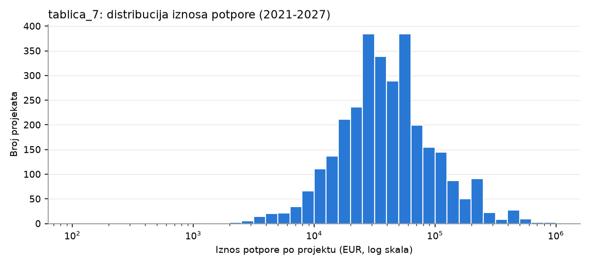
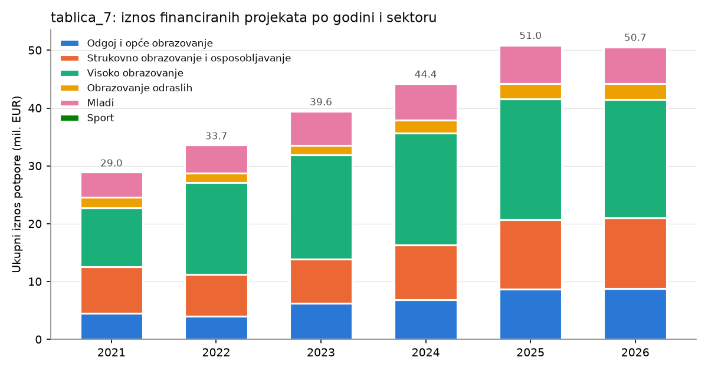
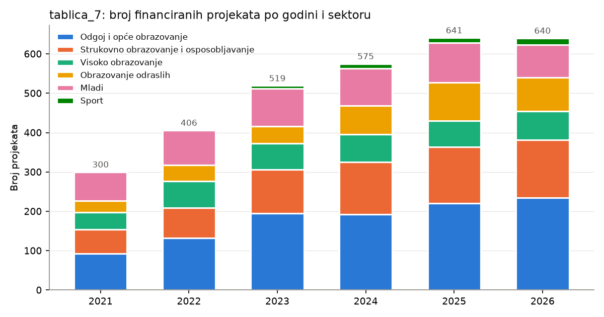
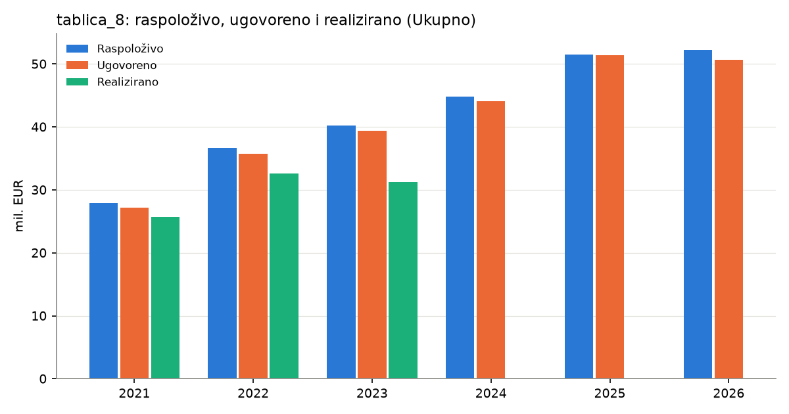
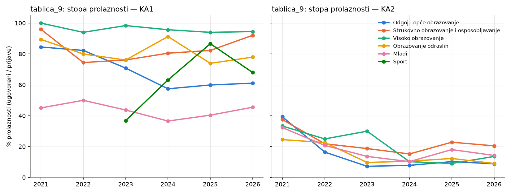
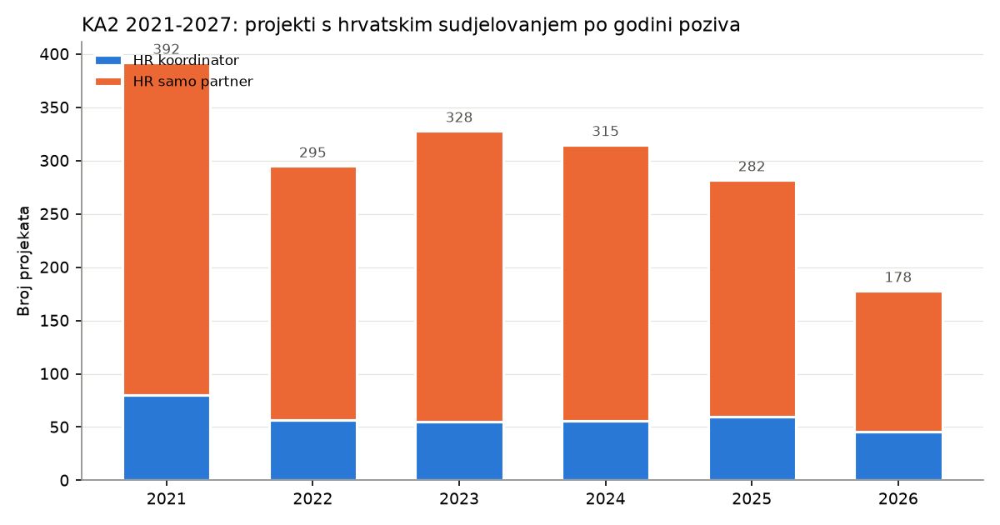

# EDA – Erasmus+ 2021–2027

Every number in this document is copied from the output of the scripts in `EDA/Scripts/`, run with the argument `2021-2027` in the `datathon` conda env. These are the same scripts used for 2014–2020, generalised to handle both periods; the 2014–2020 outputs were re-checked and are unchanged. Where something could not be determined from the data, it is marked as **open question** rather than explained.

| Script | What it does |
|---|---|
| `01_inspect_structure.py` | Raw structure of the `tablica_*.xlsx` files |
| `03_peek_ka2_xls.py` | Sheets/dimensions/first rows of the KA2 `.xls` |
| `04_project_list_non_project_rows.py` | Lists title / section / subtotal rows of the project list (tablica_7) |
| `05_parse_project_list.py` | Parses tablica_7 → `Data/processed/project_list_2021-2027.csv` |
| `06_eda_project_list.py` | Descriptive stats + charts for tablica_7 |
| `07_eda_finance_applications.py` | Tidies tablica_8 and tablica_9, consistency checks, cross-check vs tablica_7, charts |
| `08_load_cache_ka2.py` | Loads the KA2 `.xls` → `Data/processed/ka2_2021-2027.parquet` |
| `09_eda_ka2.py` | EU-wide and Croatia-focused EDA of the KA2 file + chart |
| `10_column_inventory.py` | Column names, fill counts and example values for the *Columns* subsections |
| `11_adhoc_checks.py` | Checks first run as one-off commands: title texts and ID formats, KA2 field separators, full dump of the finance/application tables, placeholder summaries and `NA` cells, postal-code formats |
| `12_verify.py` | Bug checks: reconciles parsed projects with the sheets' own subtotals, looks for unparsed project rows, duplicate suffixed IDs, numbers lost in the long tables, repeated country codes in KA2 |
| `13_verify_ka2.py` | Recomputes every KA2 table a second, independent way (original `.xls` read with `xlrd`, plain-Python aggregation) and compares the full distributions with the pipeline: 0 mismatches |

Charts are saved in `EDA/Reports/figures/2021-2027/`.

---

## 1. The data files

| File | Content (as observed) | Shape |
|---|---|---|
| `tablica_7_popis-financiranih-projekata-programa-erasmus_2021_2027.xlsx` | List of funded projects. One sheet per call year, **2021–2026** (the sheet for 2025 is named `'2025 '`, with a trailing space). | 6 sheets, 407–716 rows each |
| `tablica_8_pregled-financijskih-rezultata-programa-erasmus-2021_2027.xlsx` | Financial overview: *Raspoloživo / Ugovoreno / Realizirano* + % rows, by year × **6 sectors** (adds *Sport*) + *Ukupno*. Updated 1 Sep 2026. | 43 × 12 raw |
| `tablica_9_broj-erasmus-zaprimljenih-i-odobrenih-projekata-2021_2027..xlsx` | Applications (*Prijave*), contracted (*Ugovoreni*), *% prolaznosti* by year × **KA1/KA2** × 6 sectors. Sheet `2021-2026`. Updated 1 Sep 2026. | 44 × 11 raw |
| `ErasmusPlus_KA2_2021-2027_..._Projects_Overview_2026-10-27.xls` | EU-wide list of all KA2 projects ("Partnerships for cooperation and exchanges of practices"). 1 sheet, header on row 0. | 21,703 projects × 250 columns |

Sectors: *Odgoj i opće obrazovanje, Strukovno obrazovanje i osposobljavanje, Visoko obrazovanje, Obrazovanje odraslih, Mladi, Sport*.

All files cover call years 2021–2026; no 2027 data is present.

### 1.1 Data quality notes

- Each dataset section below (2, 3, 4, 6) starts with a **Columns and what they represent** subsection. Column names are given exactly as they appear in the files (inventory from `10_column_inventory.py`). Meanings are translations of the Croatian headers plus what is observed in the values.
- **Currency:** no column header in the tablica files states a currency; the analysis assumes EUR, as for 2014–2020.

**tablica_7** has the same report-style layout as tablica_1: one block per sector (title row *"FINANCIRANI PROJEKTI … ZA PODRUČJE …"*), with column headers, section headers, project rows and *Ukupno* subtotals.

Differences from 2014–2020:

- **New columns.** *Mjesto* (city) and *Poštanski broj* (postal code) are separate columns, so location no longer has to be parsed from the address.
- **Column headers change between years.** There are 5 header variants:
  - *Naziv korisnika* vs *Naziv prijavitelja*;
  - *Adresa korisnika* vs *Adresa*;
  - the amount column is called *Iznos odobrenih bespovratnih sredstava*, *Odobreni iznos bespovratnih sredstava* or *Ukupan iznos odobrenih sredstava po projektu*.

  The parser therefore maps columns by header name.
- **Deadline.** The *Rok* column exists only in the 2021 sheet.
- **Title wording changed.** *"ODGOJA I OPĆEG OBRAZOVANJA"* instead of *"OPĆEG ODGOJA I OBRAZOVANJA"*. Sport blocks (*"PODRUČJE SPORTA"*) appear from 2023.
- **Section headers are inconsistent.** 116 project rows (some youth and sport blocks) have no *Ključna aktivnost* header above them. Deadline rows come in many forms: `Rok (1)`, `2. rok`, `Rok, 8. listopada 2024.`, `Rok 23. veljače 2023.`.
  - KA1/KA2 was therefore derived from the KA code in the project ID.
  - Where a header exists, it agrees with the KA code in 100% of rows (2,656 KA1, 309 KA2).
- **Project ID format.** `YYYY-R-HR01-KAxxx-{SCH|VET|HED|ADU|YOU|SPO}-#########`. The field code is always present and maps 1:1 to the sector:

  | Field code | Sector |
  |---|---|
  | SCH | Odgoj i opće obrazovanje |
  | VET | Strukovno obrazovanje i osposobljavanje |
  | HED | Visoko obrazovanje |
  | ADU | Obrazovanje odraslih |
  | YOU | Mladi |
  | SPO | Sport |
- **4 malformed IDs** lack the hyphen before the number, all in 2024 KA210-ADU (e.g. `2024-2-HR01-KA210-ADU000280988`). They were kept and flagged `id_malformed`.
- **1 duplicated ID**, `2024-2-HR01-KA155-YOU-000267618`, appears twice with **two different beneficiaries**: *SUMA – Udruga za održivi razvoj* (48,077.5) and *Natura i kultura* (19,317.5). Both rows were kept. *Open question:* is this a joint project or an entry error?
- **1 row has no address, city or postal code**: `2022-1-HR01-KA131-HED-000063898` (*Konzorcij The Knowledge Triangle*).
- **Postal codes and cities.** *Poštanski broj* and *Mjesto* are each filled in 3,080 of 3,081 rows (`11_adhoc_checks.py`, check 5). 139 postal codes are not plain 5-digit numbers:
  - 137 are written with a space (`10 000`) and become valid once it is removed;
  - one is `21 0000` (6 digits, *Dječji vrtić Cvit Mediterana*, Split);
  - one is `/` (2026, *KONZORCIJ "The Knowledge Triangle"*, whose *Mjesto* is also `/`).

  The empty row is the 2022 *Konzorcij The Knowledge Triangle*. City spellings vary: *Ludberg* vs *Ludbreg*; *Grad Zagreb* appears as a city.
- **Beneficiary names are not standardised.** For example, *Sveučilište u Zagrebu* vs *SVEUČILIŠTE U ZAGREBU*. There are 1,325 raw strings, and 1,233 after lowercasing and collapsing whitespace.
  - 48 normalised names appear in more than one city. Some are clearly different organisations sharing a generic name: *Tehnička škola* (Požega, Slavonski Brod, Šibenik) and *Obrtnička škola* (Opatija, Požega, Split).
  - Others look like address variants of the same organisation: *Sveučilište Sjever* (Koprivnica, Varaždin) and *Veleučilište u Šibeniku* (Zagreb, Šibenik).

**tablica_8**:

- Footnote \*: *"Financiranje decentraliziranih projekata u području sporta započelo je od Poziva za 2023."* (decentralised sport funding started with the 2023 call).
- Footnote \*\*: *"Projekti iz razdoblja 2024.-2026. su u provedbi te trenutačno nije moguće prikazati podatke o realiziranosti sredstava za sve natječajne godine, a podaci o ugovorenosti podložni su promjenama."* (2024–2026 projects are still being implemented, so realised amounts cannot yet be shown for all years, and the contracted amounts may still change.)
- *Realizirano*:
  - complete for 2021–2023;
  - **partial for 2024**: *Visoko obrazovanje* and *Ukupno* are empty;
  - **empty for 2025 and 2026**.
- *% realiziranih sredstava* *Ukupno* is empty for 2022, although the sector values are filled.
- The *Sveukupno* row for *% realiziranih sredstava\** is empty.
- **The *Sveukupno* realised total (108,457,844) does not equal the sum of the yearly *Ukupno* values (89,636,949).** The difference, 18,820,895, equals the sum of the 2024 sector values that are filled in. So the overall total includes partial 2024 data. Realised amounts should not be compared across years from this table.
- Otherwise, sector columns sum exactly to *Ukupno* and yearly rows sum exactly to *Sveukupno*.

**tablica_9** has an extra KA1/KA2 level. It has no per-year total across both KAs; the scripts compute KA1+KA2 sums. All internal sums check out exactly: sectors → *Ukupno*, and years → *Sveukupno prema sektorskom području*.

**KA2 .xls**:

- *Project Identifier* is now a plain number (e.g. `101052513`) instead of the 2014–2020 `…-EPPKA2-…` code.
- There is one extra column, `Unnamed: 249`. It has a single non-empty value: *"And 3 more partners"*.
- The country code `NA` (Namibia) would be read as missing by pandas' defaults. The loader keeps it: 28 cells, including 1 coordinator country.
  - **All 28 were verified as Namibia** by `11_adhoc_checks.py`, check 4. *Region* is empty for them, but every organisation is Namibian (e.g. *UNIVERSITY OF NAMIBIA UNAM*, *NAMIBIA UNIVERSITY OF SCIENCE AND TECHNOLOGY*, *MUNICIPALITY OF SWAKOPMUND*), with addresses in Windhoek, Swakopmund or Otjiwarongo.
  - No *Project Summary* is `NA` in this file.
- Names appear with and without diacritics, and sometimes in English, for the same organisation. Examples: *SVEUCILISTE U ZAGREBU* / *Sveučilište u Zagrebu*; *SVEUCILISTE U RIJECI* / *Sveučilište u Rijeci* / *University of Rijeka*. Counts by name are therefore split across variants.

---

## 2. tablica_7 – Funded projects (Croatian National Agency list)

**3,081 project rows, 3,080 unique project IDs, total 248,391,491.35 EUR.**

### Columns and what they represent

*One sheet per year 2021–2026.*

| Column (header variants) | Meaning | Observed values |
|---|---|---|
| `Projektni broj` | Project number | `YYYY-R-HR01-KAxxx-FFF-NNNNNNNNN` (e.g. `2021-1-HR01-KA122-SCH-000015035`): call year, round digit, `HR01`, key-action code, field code, 9-digit number. The field code is SCH, VET, HED, ADU, YOU or SPO and maps 1:1 to the sector. 4 IDs lack the hyphen before the number |
| `Naziv korisnika` (2021–2025) / `Naziv prijavitelja` (2026) | Beneficiary name (*korisnik* = beneficiary) / applicant name (*prijavitelj* = applicant) | Free text; letter case varies |
| `Adresa korisnika` (2021–2025) / `Adresa ` (2026) | Address | Street and number only |
| `Mjesto` | City / place | e.g. *Zagreb*, *Slatine*; spelling variants exist (*Ludberg*/*Ludbreg*) |
| `Poštanski broj` | Postal code | 5 digits, as a number or as text with a space (`10 000`, 137 rows); 1 empty; 1 `21 0000`; 1 `/` |
| `Rok` (2021 sheet only) | Deadline | A date |
| `Iznos odobrenih bespovratnih sredstava` (2021–2025) | Amount of approved grant funds | Numeric |
| `Odobreni iznos bespovratnih sredstava` / `Ukupan iznos odobrenih sredstava po projektu` (2026, different blocks) | Approved grant amount / total approved amount per project | Numeric |

As in tablica_1, the sector (from the block title) and the key action / sub-action (from section header rows) are **not** columns; they come from the sheet layout.

#### Processed dataset: `Data/processed/project_list_2021-2027.csv` (+ `_enriched.csv`)

**What it is:** tablica_7 turned into a flat table with **one row per funded project** (3,081 rows, 3,080 unique `Projektni broj`; 1 ID appears twice, with two different beneficiaries (see 1.1)). It is created by `05_parse_project_list.py 2021-2027`. The `_enriched` version adds normalised names and location; it is created by `06_eda_project_list.py 2021-2027`.

**Column headers are in Croatian.** The names are defined in `Scripts/nazivi_stupaca.py`; the scripts translate them back to short internal names when they read the file. CSV files are saved as UTF-8 with BOM, so Excel shows č, ć, š, ž and đ correctly.

**How it was built (step by step):**

1. Every year sheet is read without assuming where the header is. Only the first 8 columns are used (kept the same as for 2014–2020).
2. The sheet is read top to bottom while the script remembers its current context:
   - the **sector**, from the last block title (*…ZA PODRUČJE …*, matched by keyword to the six sector names);
   - the last ***Ključna aktivnost …*** header;
   - the last **sub-action** header (a text-only row such as *Razmjene mladih* or *Mala partnerstva (KA210)*).
3. Each column-header row (*Projektni broj …*) sets which column holds which field. This works by matching words in the header (`naziv` → beneficiary, `adresa` → address, `mjesto` → city, `poštanski` → postal code, `rok` → deadline, `iznos` → amount), so that header variants between years are handled.
4. A row becomes a project only if its first cell matches the project-ID pattern `YYYY-R-HR01-KAxxx[-FIELD]-number`. The parts of the ID are split into `Natječajna godina`, `Krug natječaja`, `Šifra ključne aktivnosti`, `Šifra područja` and `Redni broj projekta`. The hyphen before the number is optional; IDs without it are flagged in `Neispravan projektni broj`.
5. All other rows are **not kept as rows**:
   - titles and column-header rows;
   - section headers (used only as context, step 2);
   - deadline rows (`Rok …`);
   - subtotals (`Ukupno`, `subtotal`, `… total`, `… sveukupno`);
   - update-date rows.
6. Value cleaning:
   - surrounding whitespace is removed from all text;
   - deadlines are converted to dates, from Excel dates or from text `d.m.yyyy.` (spaces inside removed);
   - text amounts in Croatian format would be converted, but none occur in this period.
7. `Ključna aktivnost` = the first three characters of `Šifra ključne aktivnosti` (`KA1` / `KA2` / `KA3`).
8. Enriched file only:
   - `Naziv korisnika (normaliziran)` = the name lowercased with whitespace collapsed;
   - location taken from the *Mjesto* / *Poštanski broj* columns: `Mjesto (očišćeno)` is *Mjesto* in title case, and `Poštanski broj (očišćen)` is *Poštanski broj* with spaces removed (`10 000` → `10000`), as text.

**Deliberately NOT changed:**

- names, addresses and city spellings are not corrected or merged;
- duplicate IDs are kept;
- amounts are not reconciled against the subtotal rows in the sheet.

**Columns** (fill counts out of 3,081 rows):

| Column | Meaning | Filled |
|---|---|---|
| `List`, `Redak` | Sheet name and row number in the Excel file (for tracing back) | all |
| `Sektor` | Sector from the block title | all |
| `Zaglavlje ključne aktivnosti` | Text of the last *Ključna aktivnost …* header above the row | 2,965 (116 rows have no header above them) |
| `Zaglavlje podaktivnosti` | Text of the last sub-action header above the row | 711 |
| `Projektni broj` | Project number as written (whitespace stripped) | all |
| `Natječajna godina`, `Krug natječaja`, `Šifra ključne aktivnosti`, `Šifra područja`, `Redni broj projekta` | Parts of the project ID | all; `Šifra područja` 3,081 |
| `Naziv korisnika`, `Adresa korisnika` | As written in the sheet | all; `Adresa korisnika` 3,080 |
| `Mjesto`, `Poštanski broj` | *Mjesto* / *Poštanski broj* as written | 3,080 / 3,080 |
| `Rok` | *Rok* as a date | 300 (only the 2021 sheet has a *Rok* column) |
| `Iznos (EUR)` | Approved amount (currency assumed EUR) | all |
| `Ključna aktivnost` | `KA1` / `KA2` / `KA3` from `Šifra ključne aktivnosti` | all |
| `Neispravan projektni broj` | True if the ID lacks the hyphen before the number | 4 True |
| `Naziv korisnika (normaliziran)` *(enriched)* | Lowercased, whitespace-collapsed name | all |
| `Poštanski broj (očišćen)`, `Mjesto (očišćeno)` *(enriched)* | Cleaned location (see step 8) | 3,079 (3,078 valid 5-digit codes + `210000`) / 3,080 (incl. one `/`) |

### 2.1 Grant amount distribution (EUR)

| count | mean | std | min | 25% | median | 75% | max |
|---:|---:|---:|---:|---:|---:|---:|---:|
| 3,081 | 80,620 | 281,792 | 1,240 | 23,329 | 38,630 | 67,529 | 6,574,873 |

The most frequent single amounts are round numbers: 60,000 (155 projects), 250,000 (58), 120,000 (28), 400,000 (21) and 30,000 (19).

### 2.2 By call year

| Year | Projects | Total EUR | Mean | Median |
|---:|---:|---:|---:|---:|
| 2021 | 300 | 29,008,017 | 96,693 | 38,668 |
| 2022 | 406 | 33,690,807 | 82,982 | 37,158 |
| 2023 | 519 | 39,571,557 | 76,246 | 33,283 |
| 2024 | 575 | 44,366,911 | 77,160 | 39,304 |
| 2025 | 641 | 51,048,168 | 79,638 | 42,271 |
| 2026 | 640 | 50,706,032 | 79,228 | 40,142 |

The total amount grows every year up to 2025 (51.0M EUR). 2026 is about the same as 2025, with 640 projects and 50.7M EUR. All 2026 projects are round 1 (see 2.5).

### 2.3 By sector

| Sector | Projects | Total EUR | Mean | Median |
|---|---:|---:|---:|---:|
| Odgoj i opće obrazovanje | 1,067 | 39,142,779 | 36,685 | 29,070 |
| Strukovno obrazovanje i osposobljavanje | 673 | 56,631,289 | 84,148 | 68,951 |
| Visoko obrazovanje | 387 | 104,863,533 | 270,965 | 83,270 |
| Obrazovanje odraslih | 370 | 12,560,102 | 33,946 | 16,666 |
| Mladi | 535 | 34,625,411 | 64,720 | 44,944 |
| Sport | 49 | 568,378 | 11,600 | 10,966 |

- *Odgoj i opće obrazovanje* has the most projects (1,067).
- *Visoko obrazovanje* has the largest total: 104.9M EUR, 42% of the tablica_7 total.
- *Sport* (from 2023) is small: 49 projects and 0.57M EUR.

Sector × year, total EUR:

| Sector | 2021 | 2022 | 2023 | 2024 | 2025 | 2026 |
|---|---:|---:|---:|---:|---:|---:|
| Odgoj i opće obr. | 4,493,838 | 3,964,836 | 6,292,438 | 6,863,819 | 8,712,052 | 8,815,795 |
| Strukovno | 8,069,943 | 7,248,852 | 7,625,376 | 9,459,807 | 12,012,405 | 12,214,906 |
| Visoko | 10,162,208 | 15,960,134 | 18,020,198 | 19,384,655 | 20,879,674 | 20,456,664 |
| Odrasli | 1,807,902 | 1,559,054 | 1,636,486 | 2,171,723 | 2,605,233 | 2,779,704 |
| Mladi | 4,474,126 | 4,957,931 | 5,893,695 | 6,357,682 | 6,685,427 | 6,256,550 |
| Sport | – | – | 103,363 | 129,225 | 153,377 | 182,413 |

Sector × year, project counts:

| Sector | 2021 | 2022 | 2023 | 2024 | 2025 | 2026 |
|---|---:|---:|---:|---:|---:|---:|
| Odgoj i opće obr. | 93 | 132 | 195 | 192 | 221 | 234 |
| Strukovno | 61 | 77 | 111 | 133 | 143 | 148 |
| Visoko | 43 | 68 | 67 | 71 | 66 | 72 |
| Odrasli | 30 | 41 | 43 | 73 | 97 | 86 |
| Mladi | 73 | 88 | 96 | 94 | 101 | 83 |
| Sport | – | – | 7 | 12 | 13 | 17 |

### 2.4 By key action and KA code

| Key action | Projects | Total EUR | Mean | Median |
|---|---:|---:|---:|---:|
| KA1 | 2,772 | 201,540,001 | 72,706 | 35,299 |
| KA2 | 309 | 46,851,490 | 151,623 | 120,000 |

There are no KA3 projects in tablica_7 (in 2014–2020 there were 65 KA347).

| KA code | Sector(s) | Projects | Total EUR | Median |
|---|---|---:|---:|---:|
| KA131 | Visoko | 236 | 83,871,485 | 76,658 |
| KA121 | Odgoj 615, Strukovno 397, Odrasli 116 | 1,128 | 57,175,192 | 38,484 |
| KA220 | Odgoj 29, Strukovno 30, Visoko 26, Odrasli 24, Mladi 44 | 153 | 35,531,490 | 250,000 |
| KA122 | Odgoj 378, Strukovno 220, Odrasli 196 | 794 | 24,340,825 | 23,349 |
| KA171 | Visoko | 125 | 13,175,141 | 58,510 |
| KA151 | Mladi | 130 | 12,127,955 | 94,996 |
| KA210 | Odgoj 44, Strukovno 26, Odrasli 34, Mladi 51 | 155 | 10,920,000 | 60,000 |
| KA152 | Mladi | 144 | 4,987,256 | 34,068 |
| KA154 | Mladi | 91 | 3,246,253 | 32,270 |
| KA153 | Mladi | 57 | 1,602,419 | 28,567 |
| KA182 | Sport | 49 | 568,378 | 10,966 |
| KA155 | Mladi | 18 | 445,098 | 21,012 |
| KA240 | Odgoj | 1 | 400,000 | 400,000 |

KA code × year, project counts:

| KA | 2021 | 2022 | 2023 | 2024 | 2025 | 2026 |
|---|---:|---:|---:|---:|---:|---:|
| KA121 | 35 | 63 | 179 | 252 | 290 | 309 |
| KA122 | 99 | 160 | 143 | 116 | 144 | 132 |
| KA131 | 38 | 41 | 37 | 40 | 40 | 40 |
| KA171 | 0 | 22 | 24 | 27 | 23 | 29 |
| KA151 | 7 | 14 | 23 | 27 | 28 | 31 |
| KA220 | 47 | 21 | 24 | 22 | 18 | 21 |
| KA210 | 26 | 25 | 25 | 27 | 27 | 25 |
| KA182 | 0 | 0 | 7 | 12 | 13 | 17 |

- KA121 grows from 35 projects (2021) to 309 (2026). It is the largest code by number of projects (1,128).
- KA220 drops from 47 (2021) to 18–24 per year afterwards.
- KA240 appears only in 2026 (1 project).

### 2.5 Call round (digit after the year in the project ID)

| Round | 2021 | 2022 | 2023 | 2024 | 2025 | 2026 |
|---:|---:|---:|---:|---:|---:|---:|
| 1 | 267 | 309 | 486 | 538 | 610 | 640 |
| 2 | 33 | 69 | 12 | 18 | 12 | 0 |
| 3 | 0 | 28 | 21 | 19 | 19 | 0 |

2026 contains round-1 projects only. *Open question:* whether later 2026 rounds are missing because they had not yet been decided. The 2026 sheet is dated 11 Aug 2026.

### 2.6 Largest and smallest grants

All 10 largest grants are KA131 (higher-education mobility):

- Six go to Sveučilište u Zagrebu, one per year: 3,345,350 (2021), 5,245,518 (2022), 5,771,271 (2023), 6,516,580 (2024), **6,574,873 (2025)**, 5,988,850 (2026).
- The rest go to Split (2024–2026) and Rijeka (2025).

The smallest grant is 1,240 (Obrtnička škola Koprivnica, KA122, 2021). The 10 smallest are all ≤ 3,065, mostly KA122, KA121, KA182 and youth codes.

### 2.7 Beneficiaries (lowercased + whitespace-normalised names)

- 1,233 distinct beneficiaries.
- 717 of the 1,325 raw name strings have exactly 1 project.
- The **top 10 beneficiaries by amount receive 34.9%** of the total.

| Top by amount | Projects | Total EUR |
|---|---:|---:|
| sveučilište u zagrebu | 24 | 38,909,752 |
| sveučilište u splitu | 14 | 12,300,319 |
| sveučilište u rijeci | 17 | 11,712,348 |
| sveučilište j. j. strossmayera u osijeku | 13 | 9,187,279 |
| sveučilište u zadru | 11 | 4,854,161 |
| sveučilište u dubrovniku | 13 | 2,738,387 |
| zagrebačka škola ekonomije i managementa | 7 | 1,980,263 |
| sveučilište sjever | 11 | 1,808,316 |
| sveučilište jurja dobrile u puli | 9 | 1,697,475 |
| elektrotehnička i prometna škola osijek | 11 | 1,559,142 |

Sveučilište u Zagrebu alone receives 38.9M EUR, 15.7% of the total. The most frequent beneficiaries by count are also universities, plus *Tehnička škola* (16, three different schools) and *Institut za poticanje mladih* (14).

### 2.8 Location (from the *Mjesto* / *Poštanski broj* columns)

| City | Projects | Total EUR |
|---|---:|---:|
| Zagreb | 804 | 89,588,100 |
| Osijek | 170 | 18,659,720 |
| Rijeka | 152 | 18,346,632 |
| Split | 151 | 21,542,392 |
| Slavonski Brod | 87 | 5,561,509 |
| Čakovec | 73 | 4,877,337 |
| Bjelovar | 68 | 3,333,530 |
| Koprivnica | 65 | 3,648,496 |
| Varaždin | 65 | 4,405,992 |
| Šibenik | 58 | 3,835,085 |

Postal-code prefix `10` (Zagreb area) has 969 projects and 97.0M EUR, **39.1% of the total amount** (2014–2020: about 41%). Prefix `21` (Split area) has 9.7% and prefix `31` (Osijek area) 9.2%.

---

## 3. tablica_8 – Financial overview (EUR)

### Columns and what they represent

*One sheet.*

| Column | Meaning |
|---|---|
| `Natječajna godina` | Call year (`2021.`–`2026.`, plus `Sveukupno` = grand total) |
| *(column 1, unnamed)* | Empty |
| `Stavka` | Line item. Values below |
| `Odgoj i opće obrazovanje`, `Strukovno obrazovanje i osposobljavanje`, `Visoko obrazovanje`, `Obrazovanje odraslih`, `Mladi` | Sector columns: school, VET, higher education, adult education, youth |
| `Sport*` | Sector: sport. Footnote \*: decentralised sport projects were funded from the 2023 call onwards |
| `Ukupno` | Total across sectors |

`Stavka` values:

| Value | Meaning |
|---|---|
| `Raspoloživo` | Available funds |
| `Ugovoreno` | Contracted funds |
| `Realizirano` / `Realizirano**` | Realised funds. Footnote \*\*: 2024–2026 projects are still being implemented, so realised amounts can't be shown for all years, and contracted amounts may still change |
| `% ugovorenih sredstava` | Share contracted (= Ugovoreno ÷ Raspoloživo, as in tablica_2) |
| `% realiziranih sredstava` | Share realised (= Realizirano ÷ Ugovoreno) |

#### Processed dataset: `Data/processed/finance_2021-2027_long.csv`

**What it is:** tablica_8 reshaped from its printed wide layout into **long format**: one row per *year × item × sector* (245 rows = 7 year labels (2021–2026 + *Sveukupno*) × 5 items × 7 sector columns (6 sectors + *Ukupno*)). It is created by `07_eda_finance_applications.py 2021-2027`. Long format makes it easy to filter and pivot (e.g. *Ugovoreno* by sector) and to join with the project list on `Natječajna godina` + `Sektor`.

**Column headers are in Croatian.** The names are defined in `Scripts/nazivi_stupaca.py`; the scripts translate them back to short internal names when they read the file. CSV files are saved as UTF-8 with BOM, so Excel shows č, ć, š, ž and đ correctly.

**How it was built:**

1. The header row is found by looking for `Natječajna godina` in column 0.
2. Sector columns are found by matching header text to the sector names, with asterisks removed (`Sport*` → `Sport`). The total column is the one whose header starts with `Ukupno`; it is renamed `Ukupno`.
3. The item column is the column just left of the first sector column. Rows with no item label (titles, footnotes, update date) are dropped.
4. The year label appears only on the first row of each block, so it is filled down. Trailing `.` and line breaks are removed (`2021.\n` → `2021`). Total rows keep their label (e.g. `Sveukupno`).
5. Asterisks (footnote markers) are removed from item labels in `Stavka`; the original label is kept in `Stavka (izvorno)`.
6. The table is reshaped from wide to long, and `Vrijednost` is converted to a number.

**Values:**

- Numbers are as in the source.
- % rows are stored as fractions (0–1), not recomputed.
- Empty source cells stay as empty `Vrijednost` rows: 50 empty cells: *Sport* in 2021–2022, *Realizirano* and *% realiziranih* where tablica_8 leaves them empty (2022 *Ukupno* %, 2024–2026), and the empty *Sveukupno* % row.

**Columns:**

| Column | Meaning |
|---|---|
| `Natječajna godina` | Call year as text, or the total-row label |
| `Ključna aktivnost` | always `all` (the finance table has no KA split) |
| `Stavka` | `Raspoloživo`, `Ugovoreno`, `Realizirano`, `% ugovorenih sredstava`, `% realiziranih sredstava` |
| `Stavka (izvorno)` | Item label exactly as written (with `*` / `**`) |
| `Sektor` | Sector name, or `Ukupno` for the total column |
| `Vrijednost` | The number in that cell |

| Year | Raspoloživo | Ugovoreno | Realizirano | % ugovoreno | % realizirano |
|---|---:|---:|---:|---:|---:|
| 2021 | 27,962,490 | 27,183,141 | 25,720,807 | 97.2% | 94.6% |
| 2022 | 36,674,292 | 35,701,318 | 32,651,067 | 97.3% | *(empty)* |
| 2023 | 40,190,603 | 39,368,016 | 31,265,075 | 98.0% | 79.4% |
| 2024 | 44,788,769 | 44,054,814 | *(empty)\*\** | 98.4% | *(empty)* |
| 2025 | 51,456,165 | 51,355,774 | *(empty)\*\** | 99.8% | – |
| 2026 | 52,259,723 | 50,706,032 | *(empty)\*\** | 97.0% | – |
| **Sveukupno** | **253,332,043** | **248,369,095** | **108,457,844\*\*** | **98.0%** | *(empty)* |

**Contracted amounts** (*Ugovoreno*) grow from 27.2M EUR (2021) to 51.4M (2025), then 50.7M (2026). 98.0% of the available budget is contracted overall. The lowest contracting rates are:

- *Mladi* 2026: 81.8%
- *Odgoj i opće obrazovanje* 2022: 88.6%

**% realizirano by sector** (only filled cells):

| Year | Odgoj | Strukovno | Visoko | Odrasli | Mladi | Sport |
|---|---:|---:|---:|---:|---:|---:|
| 2021 | 96.2% | 97.3% | 92.4% | 97.5% | 93.4% | – |
| 2022 | 94.6% | 96.8% | 86.1% | 98.7% | 95.0% | – |
| 2023 | 79.4% | 92.6% | 71.9% | 68.3% | 87.0% | 97.0% |
| 2024\*\* | 77.6% | 86.5% | – | 45.2% | 64.2% | 93.1% |

According to footnote \*\*, the 2024+ realisation figures are incomplete because the projects are still running. The 2023 values may also not be final; the table doesn't say.

**Sport** (from 2023): Raspoloživo 106,808 → 187,974 and Ugovoreno 103,363 → 182,413 between 2023 and 2026.

---

## 4. tablica_9 – Applications vs contracted projects (split by KA1 / KA2)

### Columns and what they represent

*Sheet `2021-2026`.*

| Column | Meaning |
|---|---|
| `Natječajna godina` | Call year (`2021.`–`2026.`, plus `Sveukupno prema sektorskom području` = total by sector) |
| *(KA column, unnamed)* | `KA1` or `KA2`, filled on the first row of each KA block. New compared with tablica_3 |
| *(item column, unnamed)* | `Prijave` (applications), `Ugovoreni` (contracted projects), `% prolaznosti` (success rate = Ugovoreni ÷ Prijave) |
| The 5 sector columns + `Sport` | Counts per sector. *Sport* is filled only for KA1 from 2023 |
| `Ukupno prema natječajnoj godini` | Total for the call year and KA (sum of sectors) |

#### Processed dataset: `Data/processed/applications_2021-2027_long.csv`

**What it is:** tablica_9 reshaped from its printed wide layout into **long format**: one row per *year × KA × item × sector* (273 rows = 6 years × 2 KAs × 3 items × 7 sector columns, plus the overall total (3 items × 7)). It is created by `07_eda_finance_applications.py 2021-2027`. Long format makes it easy to filter and pivot (e.g. *Ugovoreni* by sector) and to join with the project list on `Natječajna godina` + `Sektor`.

**Column headers are in Croatian.** The names are defined in `Scripts/nazivi_stupaca.py`; the scripts translate them back to short internal names when they read the file. CSV files are saved as UTF-8 with BOM, so Excel shows č, ć, š, ž and đ correctly.

**How it was built:**

1. The header row is found by looking for `Natječajna godina` in column 0.
2. Sector columns are found by matching header text to the sector names, with asterisks removed (`Sport*` → `Sport`). The total column is the one whose header starts with `Ukupno`; it is renamed `Ukupno`.
3. The item column is the column just left of the first sector column. Rows with no item label (titles, footnotes, update date) are dropped. The unnamed KA column is found automatically (its values look like `KA1`) and filled down each KA block. **KA1+KA2 sums per year are not stored**; script 07 computes them when it runs.
4. The year label appears only on the first row of each block, so it is filled down. Trailing `.` and line breaks are removed (`2021.\n` → `2021`). Total rows keep their label (e.g. `Sveukupno`).
5. Asterisks (footnote markers) are removed from item labels in `Stavka`; the original label is kept in `Stavka (izvorno)`.
6. The table is reshaped from wide to long, and `Vrijednost` is converted to a number.

**Values:**

- Numbers are as in the source.
- % rows are stored as fractions (0–1), not recomputed.
- Empty source cells stay as empty `Vrijednost` rows: 24 empty cells, all *Sport*: KA2 in every year (Sport has no KA2 data), and KA1 in 2021–2022.

**Columns:**

| Column | Meaning |
|---|---|
| `Natječajna godina` | Call year as text, or the total-row label |
| `Ključna aktivnost` | `KA1` / `KA2`, or `all` on the overall total rows (which have no KA split) |
| `Stavka` | `Prijave`, `Ugovoreni`, `% prolaznosti` |
| `Stavka (izvorno)` | Item label exactly as written (with `*` / `**`) |
| `Sektor` | Sector name, or `Ukupno` for the total column |
| `Vrijednost` | The number in that cell |

KA1 + KA2 combined (summed by the script; % recomputed as Ugovoreni / Prijave):

| Year | Prijave | Ugovoreni | % prolaznosti |
|---|---:|---:|---:|
| 2021 | 545 | 306 | 56.1% |
| 2022 | 758 | 410 | 54.1% |
| 2023 | 1,111 | 520 | 46.8% |
| 2024 | 1,322 | 575 | 43.5% |
| 2025 | 1,261 | 642 | 50.9% |
| 2026 | 1,252 | 640 | 51.1% |
| **Total** | **6,249** | **3,093** | **49.5%** |

By key action (*Ukupno* column):

| Year | KA1 Prijave | KA1 Ugovoreni | KA1 % | KA2 Prijave | KA2 Ugovoreni | KA2 % |
|---|---:|---:|---:|---:|---:|---:|
| 2021 | 313 | 229 | 73.2% | 232 | 77 | 33.2% |
| 2022 | 491 | 356 | 72.5% | 267 | 54 | 20.2% |
| 2023 | 706 | 471 | 66.7% | 405 | 49 | 12.1% |
| 2024 | 843 | 526 | 62.4% | 479 | 49 | 10.2% |
| 2025 | 930 | 596 | 64.1% | 331 | 46 | 13.9% |
| 2026 | 860 | 593 | 69.0% | 392 | 47 | 12.0% |

- **KA2 is much more competitive than KA1.**
  - The KA2 success rate falls from 33.2% (2021) to 10–14% in 2023–2026.
  - KA2 applications roughly double between 2021 and 2024 (232 → 479), while the number of contracted KA2 projects falls from 77 to 46–49.
  - In 2023 and 2024, KA2 success in *Odgoj i opće obrazovanje* is 7.2% and 7.9%.
- **KA1 success rates by sector:**
  - *Visoko obrazovanje* is 94–100% in every year.
  - *Mladi* is the lowest KA1 sector, at 36.6–50.0%.
  - *Odgoj i opće obrazovanje* falls from 84.5% (2021) to 57.5–61.1% (2024–2026).
  - *Sport* (KA1 only) is 36.8% (2023), 63.2% (2024), 86.7% (2025) and 68.0% (2026).

Totals by sector, 2021–2026:

| Sector | Prijave | Ugovoreni | % prolaznosti |
|---|---:|---:|---:|
| Odgoj i opće obrazovanje | 2,174 | 1,071 | 49.3% |
| Strukovno obrazovanje i osposobljavanje | 1,001 | 675 | 67.4% |
| Visoko obrazovanje | 527 | 388 | 73.6% |
| Obrazovanje odraslih | 832 | 369 | 44.4% |
| Mladi | 1,637 | 541 | 33.0% |
| Sport | 78 | 49 | 62.8% |

---

## 5. Cross-check between tablica_7, tablica_8 and tablica_9

**Parser check first (`12_verify.py`).** The parsed tablica_7 projects were reconciled against all 166 *Ukupno* rows printed in the sheets themselves.

- 163 match exactly.
- The 3 that don't are sections where the sheet has no subtotal of its own; the next *Ukupno* covers only the last section:
  - 2023 and 2024 *Odgoj*: KA220 followed directly by KA210;
  - 2024 *Mladi*: KA152 rounds followed by KA153.
- No project-like row is left unparsed.

So tablica_7 is parsed completely, and **the gaps below are differences between the published tables, not parsing errors.**

**Project counts.** tablica_7 count minus tablica_9 *Ugovoreni* (KA1+KA2):

| Year | Odgoj | Strukovno | Visoko | Odrasli | Mladi | Sport |
|---|---:|---:|---:|---:|---:|---:|
| 2021 | 0 | −2 | 0 | 0 | −4 | – |
| 2022 | −3 | 0 | 0 | +1 | −2 | – |
| 2023 | 0 | 0 | −1 | 0 | 0 | 0 |
| 2024 | 0 | 0 | 0 | 0 | 0 | 0 |
| 2025 | −1 | 0 | 0 | 0 | 0 | 0 |
| 2026 | 0 | 0 | 0 | 0 | 0 | 0 |

The largest gap is 4 projects; 2024 and 2026 match exactly. Split by KA, the 2021 *Mladi* gap (−4) is all KA2, and the 2022 *Odgoj* gap is KA1 +1 and KA2 −4.

**Amounts.** tablica_7 sum divided by tablica_8 *Ugovoreno*:

| Year | Odgoj | Strukovno | Visoko | Odrasli | Mladi | Sport |
|---|---:|---:|---:|---:|---:|---:|
| 2021 | 1.000 | **1.353** | 1.007 | 1.000 | 0.927 | – |
| 2022 | **0.784** | 0.997 | 0.990 | 1.004 | 0.871 | – |
| 2023 | 1.000 | 1.000 | 1.027 | 1.000 | 0.955 | 1.000 |
| 2024 | 1.000 | 1.000 | 1.027 | 1.000 | 0.969 | 1.000 |
| 2025 | 1.004 | 1.000 | 1.000 | 1.000 | 0.954 | 0.961 |
| 2026 | 1.000 | 1.000 | 1.000 | 1.000 | 1.000 | 1.000 |

- tablica_7 and tablica_8 agree much better than in 2014–2020. Most cells are exactly 1.000, and 2026 matches in every sector.
- The large 2014–2020 gap for *Odgoj i opće obrazovanje* (35–90%) does not recur, except in 2022 (0.784).
- Exceptions (*open questions*):
  - *Strukovno* 2021: tablica_7 lists 8.07M EUR vs 5.96M contracted (ratio 1.353).
  - *Mladi* 2021–2025: tablica_7 is 87–97% of the contracted amount.
  - *Visoko* 2023–2024: ratio 1.027.

---

## 6. KA2 project overview (EU-wide, 2021–2026)

### Columns and what they represent

*250 columns.*

The **same column names** as the 2014–2020 KA2 file (see `report_2014_2020.md`, section 6), plus one extra column. Differences in content:

| Column | Difference in 2021–2027 |
|---|---|
| `Key Action` | Always `Partnerships for cooperation and exchanges of practices` |
| `Action Type` | 22 distinct (e.g. *Small-scale partnerships in school education*, *Cooperation partnerships in youth*, *European Universities*, *Erasmus Mundus Joint Master*) |
| `Call year` | 2021–2026 |
| `Project Identifier` | Plain number (e.g. `101052513`) |
| `Topics` | New topic vocabulary, 76 distinct (e.g. *Digital skills and competences*, *Green skills*); 9.8% empty |
| `Project Status` | Mostly `ongoing` (11,769) |
| `Coordinating organisation type` | 28 distinct; 9.8% empty |
| `Coordinator's country` | 100 distinct codes |
| `Project Website` / `Coordinator's website` | Much better filled: 80.5% / 39.9% empty |
| `Unnamed: 249` | Extra column with no header. One non-empty value: *"And 3 more partners"* |

Partner columns are the same 38 × 6 `Partner N <field>` columns. The median project has 3 partners.

#### Processed dataset: `Data/processed/ka2_2021-2027.parquet`

**What it is:** an exact copy of the EU-wide KA2 `.xls` (21,703 rows × 250 columns), saved in Parquet format (42.3 MB instead of 207.1 MB). It is created by `08_load_cache_ka2.py 2021-2027`. The only reason for it is speed: later scripts load the Parquet file instead of re-reading the large Excel file.

**Column headers:** the original English headers of the EU file, unchanged. The other processed datasets use Croatian headers.

**How it was built:**

1. The single sheet is read with `xlrd`, using row 0 as the header.
2. **Every value is read as text** (`dtype=str`), so nothing is silently converted; for example, project identifiers keep their exact form.
3. **Only empty cells count as missing** (`keep_default_na=False`). pandas would otherwise turn strings like `NA`, `N/A` or `None` into missing values. Here 28 cells hold `NA` (Namibia), including 1 coordinator country.
4. Surrounding whitespace is removed from column names. No rows or columns are removed, and no values are changed.

**Not stored in the file:** numbers and derived fields. `09_eda_ka2.py` computes these each time it runs:

- the grant as a number;
- the call year as a number;
- the list of participating countries;
- the number of partners and countries;
- the HR coordinator / participant flags.

**Columns:** the same as the original file (see the table above). To use the grant column, convert it to a number first, e.g. `pd.to_numeric(df[grant_col])`.

### 6.1 Structure and quality

- 21,703 rows, all unique *Project Identifier*.
- Grant and call year are numeric in all rows.
- *Key Action* is always *"Partnerships for cooperation and exchanges of practices"*.
- *Project Status*: ongoing 11,769 / finalized 9,884 / terminated 50.
- *Is Good Practice* = Yes: 2,696. *Results Available* = Yes: 8,957.
- Missing values:
  - *Project Website*: 80.5% (2014–2020: 98.6%)
  - *Coordinator's website*: 39.9% (97.9%)
  - *Coordinator's region*: 21.8%
  - *Topics*: 9.8%
  - *Coordinating organisation type*: 9.8%
- 32 projects have a grant of 0.

### 6.2 Overview

| Grant (EUR) | count | mean | std | min | 25% | median | 75% | max |
|---|---:|---:|---:|---:|---:|---:|---:|---:|
| | 21,703 | 280,170 | 873,396 | 0 | 60,000 | 120,000 | 250,000 | 14,400,000 |

| Call year | Projects | Total EUR | Median |
|---:|---:|---:|---:|
| 2021 | 4,594 | 990,187,924 | 160,345 |
| 2022 | 3,729 | 1,198,713,655 | 120,000 |
| 2023 | 4,124 | 1,442,943,454 | 118,262 |
| 2024 | 3,743 | 1,147,480,864 | 60,000 |
| 2025 | 3,438 | 978,170,821 | 120,000 |
| 2026 | 2,075 | 323,030,000 | 60,000 |

Unlike 2014–2020, the number of projects doesn't grow. 2026 has the fewest projects (2,075). *Open question:* whether 2026 is complete; the file is dated 2026-10-27.

Partners per project: mean 3.71, median 3 (2014–2020: 4.62 / 4). Countries per project: median 4 (2014–2020: 5).

**Action types.** The two biggest families:

| Family | Typical size | Median grant |
|---|---|---:|
| *Small-scale partnerships* (school, youth, adult, VET) | 1,892–2,958 projects each | 60,000 |
| *Cooperation partnerships* (school, VET, youth, adult) | 1,569–2,075 projects each | 250,000 |

*Cooperation partnerships in higher education* has a median of 354,735. The largest per-project grants are:

- *European Universities*: 66 projects, median 14,399,559
- *Erasmus Mundus Joint Master*: 166 projects, median 4,624,800
- *Centers of Vocational Excellence*: 73 projects, median 3,951,733

**Coordinator country:** DE 2,024 (9.3%), IT 1,973, ES 1,921, FR 1,854, PL 1,649. **HR ranks 21st of 100** (2014–2020: 27th of 84).

**Topics:** 76 distinct. The top three are *Digital skills and competences* (3,315), *Inclusion, promoting equality and non-discrimination* (3,243) and *Environment and climate change* (3,216).

### 6.3 Croatian participation

- HR appears in *Participating countries* in **1,790 projects** (8.2% of all).
- **HR is the coordinator in 354** (19.8% of HR projects).
- 1,556 projects have at least one HR partner (1,730 HR partner appearances).
- *Participating countries* agrees exactly with the coordinator/partner country fields.

| Call year | HR projects | HR-coordinated | Share of all KA2 projects | Sum of whole-project grants (EUR) |
|---:|---:|---:|---:|---:|
| 2021 | 392 | 80 | 8.5% | 90,469,582 |
| 2022 | 295 | 57 | 7.9% | 129,636,833 |
| 2023 | 328 | 55 | 8.0% | 116,736,672 |
| 2024 | 315 | 56 | 8.4% | 108,212,716 |
| 2025 | 282 | 60 | 8.2% | 77,887,082 |
| 2026 | 178 | 46 | 8.6% | 33,500,000 |

> ⚠️ The grant column is the **whole project's** grant. The Croatian share is not in the file.

Croatia's share of KA2 projects is stable at 7.9–8.6% per year. The number of HR projects follows the overall project count, which falls after 2021. HR coordinates 17–26% of its projects per year, more than in 2014–2020 (11–15%).

**HR participation by action type** (top):

| Action type | HR projects | HR-coordinated |
|---|---:|---:|
| Small-scale partnerships in school education | 252 | 44 |
| Cooperation partnerships in school education | 231 | 33 |
| Cooperation partnerships in youth | 209 | 45 |
| Cooperation partnerships in higher education | 207 | 26 |
| Cooperation partnerships in VET | 184 | 30 |
| Small-scale partnerships in youth | 171 | 55 |
| Cooperation partnerships in adult education | 146 | 24 |
| Small-scale partnerships in adult education | 139 | 36 |
| Small-scale partnerships in VET | 100 | 26 |

HR takes part in 8 European Universities, 7 Erasmus Mundus Joint Masters and 5 Teacher Academies, but coordinates none. It coordinates all 5 of its *Erasmus Mundus Design Measures* projects.

**HR coordinators** (354 projects):

- Types: NGOs 154 (43.5%), HEIs 33, VET secondary schools 29, primary schools 26.
- Region: *Grad Zagreb* 96. Region is empty for 81.
- Most frequent: SVEUCILISTE U ZAGREBU 18 projects (plus 3 more spelled *Sveučilište u Zagrebu*).
- SVEUCILISTE ALGEBRA BERNAYS has 5 projects with 7.26M EUR of whole-project grants (median 1.45M).

**HR partners:**

- 1,730 appearances, 841 distinct names (after removing leading/trailing spaces from names).
- Types: NGOs 467, HEIs 256, primary schools 143.
- Most frequent: SVEUCILISTE U ZAGREBU 100 (+29 as *Sveučilište u Zagrebu*), Ustanova za obrazovanje odraslih Dante 37, SVEUCILISTE J. J. STROSSMAYERA U OSIJEKU 29.

**Countries most often in HR projects:** IT 555, ES 481, EL 346, SI 332, TR 326, DE 303, PT 299, RO 287, PL 270, RS 219.

**Top topics in HR projects:** *Environment and climate change* (340), *New learning and teaching methods* (295), *Digital skills* (286), *Inclusion* (267).

---

## 7. 2021–2027 compared with 2014–2020 (same scripts, same metrics)

| Metric | 2014–2020 | 2021–2026 |
|---|---:|---:|
| Call years covered | 7 | 6 |
| Contracted, *Ugovoreno* (finance table) | 155.6M EUR | 248.4M EUR |
| Contracted, first year → last year | 13.0M → 37.0M | 27.2M → 50.7M |
| % contracted of available | 98.2% | 98.0% |
| Projects in project list | 2,061 | 3,081 |
| Median grant (project list) | 23,935 | 38,630 |
| Applications / contracted | 5,277 / 2,111 (40.0%) | 6,249 / 3,093 (49.5%) |
| Higher education share of project-list amount | 46% | 42% |
| Top-10 beneficiaries' share | 38.5% | 34.9% |
| Zagreb postal area (10xxx) share of amount | ~41% | 39.1% |
| KA2 EU-wide: HR projects / HR-coordinated | 2,040 / 252 | 1,790 / 354 |
| KA2 EU-wide: HR rank as coordinator country | 27 / 84 | 21 / 100 |

Realised amounts (*Realizirano*) can't be compared, because 2024–2026 are incomplete in tablica_8.

## 8. Summary of what the data shows

1. Contracted Erasmus+ funding in Croatia (tablica_8) totals 248.4M EUR for 2021–2026. It grows from 27.2M (2021) to 51.4M (2025), then 50.7M (2026). 98.0% of the available budget was contracted.
2. Realised amounts are only complete for 2021–2023. The overall realised total in tablica_8 mixes complete years with partial 2024 data.
3. Higher education is still the largest sector by money (42% of the tablica_7 total; Sveučilište u Zagrebu alone 15.7%). Its KA1 success rate is 94–100%.
4. KA1 accredited mobility (KA121) grows strongly, from 35 projects in 2021 to 309 in 2026. The KA2 partnership calls become much more competitive: success falls from 33% to 10–14% as applications rise and the number of contracted projects falls.
5. The project list (tablica_7) agrees with the finance and application tables far better than in 2014–2020.
6. In the EU-wide KA2 data, Croatia's share of projects is stable at about 8%. Croatia coordinates a larger share of its projects than before (about 20% vs about 12%).

### Open questions (not answerable from these files)

- Why tablica_7 *Strukovno* 2021 is 35% above *Ugovoreno*, and *Odgoj* 2022 is 22% below.
- Whether the duplicate KA155 project ID with two beneficiaries is one joint project.
- Whether 2026 is complete: only round-1 projects appear in tablica_7, and the KA2 file has fewer 2026 projects.
- How much of each KA2 grant goes to Croatian organisations.
