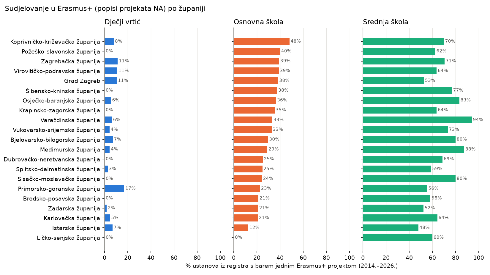
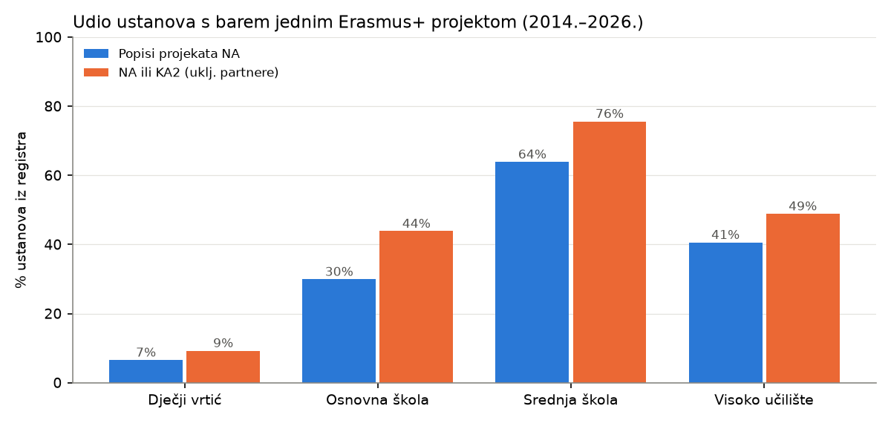

# Erasmus+ beneficiaries linked to the registers of educational institutions

This report connects sources analysed separately before:

- **the Erasmus+ project lists of the Croatian National Agency.** These are tablica_1 (2014–2020, 2,061 projects) and tablica_7 (2021–2027, 3,081 projects, call years 2021–2026); see `report_2014_2020.md` and `report_2021_2027.md`;
- **the EU-wide KA2 files** (section 5): Croatian coordinators **and partners**;
- **the registers of educational institutions.** These cover 885 kindergarten/preschool entries, 926 primary schools, 443 secondary schools and 133 higher-education institutions; see `report_obrazovne_ustanove.md`.

Every number below is copied from the output of `Scripts/17_link_registri_erasmus.py`. Where something could not be determined from the data, it is marked as an **open question**.

| Script | What it does |
|---|---|
| `17_link_registri_erasmus.py` | Links each project's beneficiary to a register entry, then describes link quality, money by register type, participation rates, a chart, and two processed files |
| `18_verify_erasmus_registri.py` | Bug check, reading the outputs with Python's `csv` module (no pandas). It confirms every project appears exactly once, amounts add up to the project-list totals, counts per institution match the linked rows, and every linked row's matched name equals the (normalised) register name. It also recomputes all report numbers: 0 differences |

Chart: `EDA/Reports/figures/erasmus_registri/`.

---

## 1. How the linking works

The two sources share **no common identifier**. Beneficiaries are therefore matched to register entries by **name and location**, accepting **exact matches only** (after the normalisation below). There is no fuzzy or similarity matching.

**Name normalisation** (applied to both sides):

- lower case;
- diacritics removed (č→c, š→s, đ→d, …);
- quotes and punctuation removed, whitespace collapsed;
- leading abbreviations expanded: *OŠ* → *osnovna škola*, *SŠ* → *srednja škola*, *DV* → *dječji vrtić*;
- a leading *l.* (letter L, a typo) read as *I.*;
- leading ordinal words turned into Roman numerals (*Prva/Druga/Treća/Četvrta* → *I./II./III./IV.*).

**Matching tiers**, tried in order. A tier is accepted only if it points to **exactly one institution**:

| Tier | Rule |
|---|---|
| 1 | same normalised name **and** same postal code |
| 2 | same normalised name **and** same place |
| 3 | same normalised name, and the name occurs **only once** in all registers |
| 4 | a defined **name variant** of the beneficiary, matched via tier 1 or 2. Variants are: the place removed from the end of the name; the part inside parentheses; the part before or after `-` or `,`. The most specific variant is tried first. Tier 3 is allowed for a variant only if the project row has no location at all. |

**Matching is to institutions, not register rows.** The 13 schools listed in both the primary and the secondary register (same *Šifra*) count as one institution. Each project row is linked independently.

**Manual review.** All 111 distinct tier-3 and tier-4 name→institution pairs were checked by eye, together with a random sample of 25 tier-1/2 links.

- An earlier version of the rules produced **4 false links**. In each case, removing the place left a generic name that was then matched to an institution in another town, e.g. *Centar za rehabilitaciju **Rijeka*** → *… **Zagreb***, *Gradska knjižnica i čitaonica **Ogulin*** → *… **Virovitica***, *Veleučilište **Ivanić-Grad*** → *Veleučilište **Velika Gorica***.
- The rules were tightened as in tier 4 above. After that, no false links were found in the review.

**Known limitations:**

- **Renamed institutions aren't linked.** Some institutions have a different name in the project lists than in the register. Examples: *Veleučilište u Slavonskom Brodu* / *Sveučilište u Slavonskom Brodu*, *Veleučilište PAR* / *Visoka poslovna škola PAR*, *Veleučilište Ivanić-Grad* / *Visoka škola Ivanić-Grad*, *Veleučilište u Križevcima* / *Visoko gospodarsko učilište u Križevcima*. No alias list was added, because that would be a judgement rather than something the data shows.
- **Grammatical variants aren't linked**, e.g. *Osnovna škola Pujanke* / *Osnovna škola Pujanki*, *Antun Kanižlić* / *Antuna Kanižlića*.
- **Faculties are partly attributed to their university.** When a beneficiary like *Sveučilište u Zagrebu (FOI)* can't be matched to the faculty in its own town, it is linked to the university. So faculty-level participation is undercounted.
- **The register date is unknown.** Institutions that closed, merged or were renamed between 2014 and the register date can't be linked.

For these reasons, **the participation rates below are likely underestimates.**

---

## 2. Link results

| Tier / result | 2014–2020 | 2021–2027 | Total |
|---|---:|---:|---:|
| 1 name + postal code | 593 | 1,462 | 2,055 |
| 2 name + place | 361 | 354 | 715 |
| 3 unique name | 10 | 19 | 29 |
| 4 name variant (via postal code) | 29 | 107 | 136 |
| 4 name variant (via place) | 25 | 6 | 31 |
| not linked: name exists several times, place/postal differ | 4 | 0 | 4 |
| not linked: no name match | 1,039 | 1,133 | 2,172 |
| **Total project rows** | **2,061** | **3,081** | **5,142** |

| | 2014–2020 | 2021–2027 |
|---|---:|---:|
| Project rows linked | 1,018 (49.4%) | 1,948 (63.2%) |
| Amount linked (EUR) | 104,584,763 of 145,598,135 (**71.8%**) | 182,232,718 of 248,391,491 (**73.4%**) |

**Share of project rows linked, by project sector:**

| Sector | 2014–2020 | 2021–2027 |
|---|---:|---:|
| Odgoj i opće obrazovanje | 90.5% | 93.0% |
| Strukovno obrazovanje i osposobljavanje | 85.6% | 92.6% |
| Visoko obrazovanje | 80.8% | 76.2% |
| Obrazovanje odraslih | 6.6% | 2.7% |
| Mladi | 2.1% | 5.2% |
| Sport | – | 0.0% |

The registers cover kindergartens, schools and higher education only. **Adult-education, youth and sport beneficiaries are mostly organisations the registers don't contain:** associations, *pučka otvorena učilišta*, other adult-education institutions, companies and sports clubs. So low link rates in those sectors are expected and don't indicate a matching failure.

Among unlinked rows, 418 have a name containing a school-like word:

- *veleučilište* 79, *pučko otvoreno učilište* 78, *učilište* 40, *visoka škola* 18;
- *osnovna škola* 18, *sveučilište* 12, *srednja škola* 6, *dječji vrtić* 3;
- 161 other.

Most are adult-education *učilišta* or private higher-education institutions not in the register, plus the renamed or differently written institutions listed in section 1.

---

## 3. Where the money goes, by register type

| Linked to | Projects 2014–2020 | Projects 2021–2027 | EUR 2014–2020 | EUR 2021–2027 | % of amount 2014–2020 | % of amount 2021–2027 |
|---|---:|---:|---:|---:|---:|---:|
| Visoko učilište | 365 | 308 | 65,296,636 | 99,297,873 | 44.8% | 40.0% |
| Srednja škola | 425 | 935 | 30,630,731 | 60,352,911 | 21.0% | 24.3% |
| Osnovna škola | 193 | 582 | 7,839,676 | 19,320,349 | 5.4% | 7.8% |
| Osnovna + srednja škola (13 combined schools) | 1 | 6 | 26,085 | 239,506 | 0.0% | 0.1% |
| Dječji vrtić | 34 | 117 | 791,635 | 3,022,079 | 0.5% | 1.2% |
| *not in the registers* | 1,043 | 1,133 | 41,013,373 | 66,158,773 | 28.2% | 26.6% |

**Between the two periods, the shares of primary schools, secondary schools and kindergartens all grow, while higher education's share falls.** In absolute numbers:

- primary-school projects: 193 → 582 (×3.0);
- kindergarten projects: 34 → 117 (×3.4);
- secondary-school projects: 425 → 935 (×2.2).

---

## 4. Participation: what share of register entries had at least one project?

| Register | Entries | ≥1 project 2014–2020 | ≥1 project 2021–2027 | ≥1 project in either | in both |
|---|---:|---:|---:|---:|---:|
| Dječji vrtić | 885 | 20 (2.3%) | 52 (5.9%) | **58 (6.6%)** | 14 (1.6%) |
| Osnovna škola | 926 | 110 (11.9%) | 235 (25.4%) | **277 (29.9%)** | 68 (7.3%) |
| Srednja škola | 443 | 172 (38.8%) | 253 (57.1%) | **283 (63.9%)** | 142 (32.1%) |
| Visoko učilište | 133 | 50 (37.6%) | 39 (29.3%) | **54 (40.6%)** | 35 (26.3%) |

The 13 combined schools count in both school rows.

- **About 2 in 3 secondary schools** and **about 3 in 10 primary schools** in the registers had at least one Erasmus+ project from the National Agency in 2014–2026.
- For both school types, the share **roughly doubled** from 2014–2020 to 2021–2027: primary from 11.9% to 25.4%, secondary from 38.8% to 57.1%.
- Kindergarten participation is low, at 6.6%. Entries named *Dječji vrtić…* participate at 7.9% (48 of 611); the other entries in that register (programme providers, associations) at 3.6% (10 of 274).

**Projects per participating entry, 2014–2026:**

| Register | Participating entries | Mean | Median | Max |
|---|---:|---:|---:|---:|
| Dječji vrtić | 58 | 2.6 | 1.5 | 8 |
| Osnovna škola | 277 | 2.8 | 2 | 14 |
| Srednja škola | 283 | 4.8 | 4 | 18 |
| Visoko učilište | 54 | 12.5 | 10.5 | 44 |

**Higher education by type:**

| Type | Entries | Participating | % |
|---|---:|---:|---:|
| Veleučilište | 17 | 17 | 100% |
| Sveučilište | 13 | 12 | 92.3% |
| Visoka škola | 20 | 15 | 75.0% |
| Fakultet | 65 | 10 | 15.4% |
| Sveučilišni odjel | 12 | 0 | 0% |
| Umjetnička akademija | 6 | 0 | 0% |

The low rates for faculties, departments and academies are expected: most university projects are contracted by the university itself, and faculties appear only when named separately (see section 1).

### 4.1 By county (kindergartens, primary and secondary schools, 2014–2026)

| County | Kindergartens % (n) | Primary % (n) | Secondary % (n) |
|---|---:|---:|---:|
| Koprivničko-križevačka | 8.0 (2) | **48.1** (13) | 70.0 (7) |
| Požeško-slavonska | 0.0 (0) | 40.0 (6) | 62.5 (5) |
| Zagrebačka | 11.3 (6) | 39.2 (20) | 70.6 (12) |
| Virovitičko-podravska | 11.1 (2) | 38.9 (7) | 63.6 (7) |
| Grad Zagreb | 10.6 (21) | 38.3 (51) | 52.6 (50) |
| Šibensko-kninska | 0.0 (0) | 37.5 (9) | 76.9 (10) |
| Osječko-baranjska | 5.6 (2) | 36.5 (27) | 83.3 (25) |
| Krapinsko-zagorska | 0.0 (0) | 35.3 (12) | 63.6 (7) |
| Varaždinska | 6.4 (3) | 33.3 (14) | **94.1** (16) |
| Vukovarsko-srijemska | 4.3 (2) | 32.7 (18) | 73.3 (11) |
| Bjelovarsko-bilogorska | 7.1 (2) | 29.6 (8) | 80.0 (12) |
| Međimurska | 4.4 (2) | 29.0 (9) | 87.5 (7) |
| Dubrovačko-neretvanska | 0.0 (0) | 25.0 (8) | 68.8 (11) |
| Splitsko-dalmatinska | 2.7 (2) | 24.8 (25) | 58.8 (30) |
| Sisačko-moslavačka | 0.0 (0) | 24.3 (9) | 80.0 (12) |
| Primorsko-goranska | **17.0** (8) | 22.6 (14) | 55.6 (20) |
| Brodsko-posavska | 0.0 (0) | 21.2 (7) | 58.3 (7) |
| Zadarska | 1.8 (1) | 21.1 (8) | 52.4 (11) |
| Karlovačka | 4.8 (1) | 20.7 (6) | 64.3 (9) |
| Istarska | 6.9 (4) | 12.5 (6) | **47.8** (11) |
| Ličko-senjska | 0.0 (0) | **0.0** (0) | 60.0 (3) |

*n* is the number of participating entries. The percentage is of all entries of that register in the county; register sizes per county are in `report_obrazovne_ustanove.md`, section 6.

- **Primary schools:** participation ranges from **0% (Ličko-senjska, 15 schools)** and **12.5% (Istarska)** to **48.1% (Koprivničko-križevačka)**.
- **Secondary schools:** from **47.8% (Istarska)** to **94.1% (Varaždinska)**.
- Grad Zagreb has the most participating schools in absolute terms (51 primary, 50 secondary). Its rates (38.3% and 52.6%) are close to the middle of the range.
- Several counties have few entries per register, e.g. 5 secondary schools in Ličko-senjska. Small differences there change the percentage a lot.
- *Open question:* the files don't explain the county differences, e.g. whether they reflect school size, county support or something else.

### 4.2 By founder (primary and secondary schools, 2014–2026)

| Founder | Primary: % participating (entries) | Secondary: % participating (entries) |
|---|---:|---:|
| town (*Grad …*) | **40.1%** (352) | 65.8% (79) |
| county (*… županija*) | 24.0% (534) | **73.1%** (301) |
| other (ministries, religious bodies, associations, companies, persons) | 17.9% (39) | 17.5% (63) |
| municipality (*Općina …*) | 100% (1) | – |

- **Primary schools founded by towns participate more often than those founded by counties:** 40.1% vs 24.0%.
- **For secondary schools it's the other way round:** county-founded 73.1% vs town-founded 65.8%.
- Schools with other founders (private, religious, ministry) participate least, at about 18%.
- *Open question:* founder type is related to location (towns vs rural areas), so the data can't tell whether founder type itself matters.

### 4.3 Most active institutions (2014–2026, by number of linked projects)

| Institution | Register | 2014–2020 | 2021–2027 | EUR total |
|---|---|---:|---:|---:|
| Sveučilište u Zagrebu | Visoko učilište | 19 | 25 | 63,232,139 |
| Sveučilište u Rijeci | Visoko učilište | 17 | 17 | 17,642,876 |
| Sveučilište u Splitu | Visoko učilište | 18 | 15 | 22,076,356 |
| Sveučilište J. J. Strossmayera u Osijeku | Visoko učilište | 16 | 13 | 15,366,226 |
| Sveučilište u Dubrovniku | Visoko učilište | 14 | 13 | 4,589,518 |
| Sveučilište u Zadru | Visoko učilište | 13 | 11 | 7,785,198 |
| Sveučilište Sjever | Visoko učilište | 13 | 11 | 2,700,222 |
| Sveučilište Jurja Dobrile u Puli | Visoko učilište | 13 | 9 | 3,075,667 |
| Veleučilište "Lavoslav Ružička" u Vukovaru | Visoko učilište | 11 | 11 | 1,283,762 |
| Veleučilište u Šibeniku | Visoko učilište | 8 | 13 | 1,733,433 |
| Veleučilište u Karlovcu | Visoko učilište | 11 | 10 | 860,960 |
| Tehničko veleučilište u Zagrebu | Visoko učilište | 11 | 9 | 2,325,503 |
| Škola za cestovni promet (Zagreb) | Srednja škola | 10 | 8 | 2,117,418 |
| Međimursko veleučilište u Čakovcu | Visoko učilište | 8 | 10 | 851,499 |
| Veleučilište u Rijeci | Visoko učilište | 9 | 9 | 850,726 |

---

### Processed datasets

Both files have Croatian headers and are saved as UTF-8 with BOM.

#### `Data/processed/erasmus_registar_poveznice.csv`

**What it is:** one row per project (5,142 rows: both periods together), with the link to the register.

**Columns:**

- **From the project list:** *Razdoblje, Projektni broj, Natječajna godina, Sektor, Ključna aktivnost, Šifra ključne aktivnosti, Naziv korisnika, Mjesto (očišćeno), Poštanski broj (očišćen), Iznos (EUR)*.
- **About the link:**
  - *Razina povezivanja*: the tier, or the reason it wasn't linked;
  - *Povezano kao (normalizirani naziv)*: the exact normalised name that matched;
  - *ID ustanove*: `S:<Šifra>` for schools, `R:<row>` for other register entries.
- **From the register:** *Registar* (*Osnovna škola + Srednja škola* for the 13 combined schools), *Naziv u registru, Mjesto u registru, Županija, Šifra ustanove, MBU, Osnivač, Tip ustanove*. These are empty when the row isn't linked.

#### `Data/processed/ustanove_erasmus_sudjelovanje.csv`

**What it is:** one row per register entry (2,387 rows), with the number of linked projects and the amounts per period.

**Columns:** the register columns from `ustanove_registar.csv`, plus *ID ustanove*, *Broj projekata 2014-2020*, *Broj projekata 2021-2027*, *Iznos 2014-2020 (EUR)* and *Iznos 2021-2027 (EUR)*.

For the 13 combined schools, the same projects appear on both their primary- and secondary-register rows, so don't sum the amounts across registers without de-duplicating by *ID ustanove*.

---

## 5. KA2 EU-wide file: Croatian coordinators **and partners**

The National Agency (NA) project lists contain only the Croatian beneficiary of each grant. The EU-wide KA2 files (see sections 6 of `report_2014_2020.md` and `report_2021_2027.md`) also list **Croatian partners in projects coordinated from abroad**. This section links every Croatian organisation in KA2 to the registers, **with exactly the same matching rules** (the code is shared via `Scripts/povezivanje.py`).

| Script | What it does |
|---|---|
| `19_link_ka2_registri.py` | Extracts every HR coordinator/partner appearance from both KA2 files and links it to the registers. Checks the links against the KA2 organisation type, cross-checks HR-coordinated projects with the NA lists by project ID, computes participation including KA2, makes a chart and writes two processed files |
| `20_verify_ka2_registri.py` | Bug check, reading the outputs with Python's `csv` module (no pandas). Recomputes the section's numbers and checks the appearance totals against the KA2 totals of the period reports: 0 differences |
| `21_verify_ka2_extraction.py` | Bug check of the extraction itself. It re-reads the original KA2 `.xls` files cell by cell with `xlrd` (no pandas, no Parquet copy) and confirms the same 4,389 appearances (project, role, partner slot, name, address). It also re-implements the postal-code parsing (0 differences) and confirms the evidence behind every link: 0 links whose name, postal code or place differs from the register entry. Finally, it confirms that no duplicated NA project ID affects the cross-check |

**What KA2 can and can't add:**

- **Location.** KA2 has no separate place or postal-code column, only an address like *street, postal code, PLACE*. The postal code was parsed from the address for 4,354 of 4,389 appearances; the place is the last part of the address.
- **Place values in KA2 aren't always clean.** For example *Vukovar Grad Vukovar* (11×), *Zagreb Grad Zagreb* (4×), *Ivanić - Grad* (6×), and *Na?ice* (3×, *Našice* with the *š* lost). 20 parsed postal codes (16 distinct) occur in neither the registers nor the NA lists. Such values can only cause missed links, never wrong ones (see `21_verify_ka2_extraction.py`).
- **Money.** The KA2 grant is the **whole project's** grant, not the Croatian partner's share. So KA2 adds to **participation**, not to "money received", and section 3 isn't extended with KA2.

### 5.1 Link results

There are 4,389 Croatian organisation appearances in KA2. These are the same totals as in the KA2 sections of the period reports.

| | 2014–2020 coordinator | 2014–2020 partner | 2021–2027 coordinator | 2021–2027 partner |
|---|---:|---:|---:|---:|
| Appearances | 252 | 2,053 | 354 | 1,730 |
| Linked | 127 (50.4%) | 1,117 (54.4%) | 110 (31.1%) | 726 (42.0%) |
| – tier 1 name + postal code | 77 | 791 | 63 | 399 |
| – tier 2 name + place | 41 | 230 | 41 | 290 |
| – tier 3 unique name | 0 | 5 | 1 | 7 |
| – tier 4 name variant | 9 | 91 | 5 | 30 |

Linked appearances by register (all periods and roles):

| Register | Appearances |
|---|---:|
| Srednja škola | 754 |
| Osnovna škola | 647 |
| Visoko učilište | 588 |
| Dječji vrtić | 76 |
| combined school | 15 |
| **not linked** | **2,309** |

Most unlinked appearances are organisations the registers don't cover. Only 228 unlinked appearances (103 distinct names) have a school or higher-education organisation type in KA2. The most frequent of these are:

- **English names:** *University of Rijeka* 14, *UNIVERSITY OF DUBROVNIK* 10, *PAR UNIVERSITY OF APPLIED SCIENCES* 6, *JURAJ DOBRILA UNIVERSITY OF PULA* 4;
- **faculties written without a separator:** e.g. *SVEUCILISTE U ZAGREBU FAKULTET ELEKTROTEHNIKE I RACUNARSTVA* 6;
- **private schools that aren't in the registers.**

**Checks of link quality:**

- **Manual review.** All 78 distinct tier-3/4 name→institution pairs were checked by eye; no false links were found.
- **KA2 organisation type vs register.**
  - 1,805 of 1,992 linked appearances (**90.6%**) have a KA2 type consistent with the register, e.g. *General education (primary level)* ↔ *Osnovna škola*.
  - Of the 187 others, **171 have a name that states the same level as the register**. The difference is only in the self-reported KA2 type. The biggest group is 107 appearances of schools named *Osnovna škola …* whose KA2 type is *General education (secondary level)*.
  - The remaining 16 (3 institutions) are special-education centres (*Centar za odgoj i obrazovanje …*, *Centar za autizam*). Their names state no level, and they match the register exactly on name and postal code.

### 5.2 Cross-check: HR-coordinated KA2 projects vs the NA project lists

KA2 projects coordinated from Croatia should, when managed by the Croatian National Agency, also be in the NA lists. Their IDs have the same format (`YYYY-R-HR01-KAxxx-…`).

IDs were compared **ignoring hyphens and the `_N` suffix**. This is needed because the NA list writes 12 KA219 projects from 2015/2016 with a `_1` suffix, and 4 IDs from 2024 lack a hyphen (see `report_2021_2027.md`).

| | 2014–2020 | 2021–2027 |
|---|---:|---:|
| HR-coordinated KA2 projects | 252 | 354 |
| … with an NA-format ID | 243 | 319 |
| … of which found in the NA lists | **240** | **307** |
| … with an EU-level ID (e.g. `…-EPPKA2-CBHE-JP`, plain numbers): not expected in NA lists | 9 | 35 |

- **In the other direction, 547 of the 551 KA2 projects in the NA lists are in the KA2 files.** The 4 that are missing are KA205 (2016), KA202 (2019), KA210 (2024) and KA240 (2026).
- **15 NA-format HR-coordinated KA2 projects aren't in the NA lists:** 1 KA219 (2016), 2 KA205 (2014, 2016), 5 KA220 (2022), 7 KA210 (2021–2022).
- One pair has the same coordinator but IDs that differ in the last digit: KA2 `2016-2-HR01-KA205-022308` vs NA `2016-2-HR01-KA205-022309` (*Centar tehničke kulture Rijeka*). *Open question:* is this the same project?

**Do the two linkings agree on the coordinator?** For the 547 projects in both sources:

| Result | Projects |
|---|---:|
| same institution | 206 |
| NA names a **faculty**, KA2 the **university** it belongs to (checked via *Nadređena ustanova*) | 8 |
| linked only via the NA list | 11 |
| linked only via KA2 | 2 |
| both unlinked (organisations not in the registers) | 320 |

So **wherever both sources link the coordinator, they point to the same institution or to a faculty and its own university** (214 of 214). There are no contradictions.

### 5.3 Participation including KA2 (2014–2026)

| Register | Entries | NA lists (section 4) | KA2, any role | KA2 coordinator | KA2 partner | **NA or KA2** | only via KA2 |
|---|---:|---:|---:|---:|---:|---:|---:|
| Dječji vrtić | 885 | 58 (6.6%) | 42 (4.7%) | 8 (0.9%) | 38 (4.3%) | **82 (9.3%)** | 24 (2.7%) |
| Osnovna škola | 926 | 277 (29.9%) | 258 (27.9%) | 43 (4.6%) | 252 (27.2%) | **406 (43.8%)** | 129 (13.9%) |
| Srednja škola | 443 | 283 (63.9%) | 225 (50.8%) | 58 (13.1%) | 213 (48.1%) | **335 (75.6%)** | 52 (11.7%) |
| Visoko učilište | 133 | 54 (40.6%) | 42 (31.6%) | 17 (12.8%) | 40 (30.1%) | **65 (48.9%)** | 11 (8.3%) |

- **Counting KA2 partnerships raises participation substantially:**
  - primary schools from 29.9% to **43.8%**;
  - secondary schools from 63.9% to **75.6%**;
  - higher education from 40.6% to **48.9%**;
  - kindergartens from 6.6% to **9.3%**.
- **129 primary schools (13.9%) appear only in KA2, all of them only as partners.** The same holds for all 52 secondary schools found only via KA2. Of the 24 kindergartens and 11 higher-education entries found only via KA2, 1 and 3 coordinated a KA2 project.
- Participation via KA2 is **mostly as partner**. Few register entries coordinated a KA2 project: 4.6% of primary schools and 13.1% of secondary schools.
- **KA2 participation is lower in 2021–2027 than in 2014–2020** (primary schools 21.7% → 14.1%, secondary 38.1% → 33.4%), while NA-list participation rose (section 4). The action type with the most Croatian participation in 2014–2020, *School Exchange Partnerships* (555 projects; see `report_2014_2020.md`), doesn't occur in the 2021–2027 KA2 file. *Open question:* whether school exchanges moved to another action is outside these files.

**By county, NA lists vs NA or KA2 (% of entries):**

| County | Primary: NA | Primary: NA or KA2 | Secondary: NA | Secondary: NA or KA2 |
|---|---:|---:|---:|---:|
| Međimurska | 29.0 | **61.3** | 87.5 | 87.5 |
| Varaždinska | 33.3 | **59.5** | 94.1 | 94.1 |
| Koprivničko-križevačka | 48.1 | 55.6 | 70.0 | 70.0 |
| Grad Zagreb | 38.3 | 53.4 | 52.6 | 66.3 |
| Krapinsko-zagorska | 35.3 | 52.9 | 63.6 | 81.8 |
| Šibensko-kninska | 37.5 | 50.0 | 76.9 | 84.6 |
| Virovitičko-podravska | 38.9 | 50.0 | 63.6 | 63.6 |
| Osječko-baranjska | 36.5 | 47.3 | 83.3 | 83.3 |
| Požeško-slavonska | 40.0 | 46.7 | 62.5 | 75.0 |
| Splitsko-dalmatinska | 24.8 | 44.6 | 58.8 | 72.5 |
| Vukovarsko-srijemska | 32.7 | 41.8 | 73.3 | 86.7 |
| Zagrebačka | 39.2 | 41.2 | 70.6 | 76.5 |
| Dubrovačko-neretvanska | 25.0 | 40.6 | 68.8 | 81.2 |
| Sisačko-moslavačka | 24.3 | 37.8 | 80.0 | 86.7 |
| Primorsko-goranska | 22.6 | 37.1 | 55.6 | 63.9 |
| Brodsko-posavska | 21.2 | 36.4 | 58.3 | 75.0 |
| Karlovačka | 20.7 | 34.5 | 64.3 | 85.7 |
| Istarska | 12.5 | 33.3 | 47.8 | **82.6** |
| Bjelovarsko-bilogorska | 29.6 | 29.6 | 80.0 | 80.0 |
| Zadarska | 21.1 | 23.7 | 52.4 | 76.2 |
| Ličko-senjska | 0.0 | **6.7** | 60.0 | 80.0 |

- **The county ranking changes when KA2 is included.**
  - For primary schools, Međimurska (61.3%) and Varaždinska (59.5%) move to the top. Ličko-senjska stays lowest (6.7%, 1 of 15 schools).
  - Istarska secondary schools rise from 47.8% to 82.6%.
- Kindergarten participation stays below 18% in every county; see the processed file for details.

**Most KA2 appearances** (both periods, all roles):

| Institution | Appearances |
|---|---:|
| Sveučilište u Zagrebu | 242 |
| Sveučilište u Rijeci | 70 |
| Sveučilište u Splitu | 53 |
| Sveučilište J. J. Strossmayera u Osijeku | 49 |
| Sveučilište u Dubrovniku | 24 |
| Sveučilište u Zadru | 24 |
| Gimnazija Metković | 22 |
| I. osnovna škola Čakovec | 21 |
| Visoka poslovna škola PAR | 20 |
| Srednja škola Metković | 19 |

### 5.4 Processed datasets (KA2)

Both files have Croatian headers and are saved as UTF-8 with BOM.

#### `Data/processed/ka2_hr_organizacije_poveznice.csv`

**What it is:** one row per Croatian organisation appearance in KA2 (4,389 rows).

**Columns:**

- **From KA2:** *Razdoblje, Identifikator projekta, Natječajna godina, Vrsta aktivnosti, Uloga* (*koordinator* / *partner*), *Partner br., Naziv organizacije, Vrsta organizacije, Adresa, Regija*.
- **Parsed from the address:** *Poštanski broj (iz adrese)*, *Mjesto (iz adrese)*.
- **Whole-project grant:** *Iznos EU potpore projekta (EUR)*. This is not the Croatian share.
- **About the link:** *Razina povezivanja, Povezano kao (normalizirani naziv), ID ustanove*.
- **From the register:** *Registar, Naziv u registru, Mjesto u registru, Županija*.

#### `Data/processed/ustanove_ka2_sudjelovanje.csv`

**What it is:** one row per register entry (2,387 rows).

**Columns:** *Vrsta registra, ID ustanove, Naziv, Mjesto, Županija, Šifra ustanove, MBU*, the NA project counts (*Broj projekata 2014-2020 / 2021-2027*), and the KA2 appearance counts by role and period (*KA2 koordinator 2014-2020*, *KA2 partner 2014-2020*, *KA2 koordinator 2021-2027*, *KA2 partner 2021-2027*).

---

## 6. Summary

1. **About 72–73% of Erasmus+ money** in the National Agency project lists goes to institutions found in the registers. Higher education takes the largest part: 44.8% in 2014–2020 and 40.0% in 2021–2027. Secondary schools follow with 21.0% and 24.3%.
2. **Participation has broadened.** The share of primary schools with a project rose from 11.9% to 25.4%, secondary schools from 38.8% to 57.1%, and kindergartens from 2.3% to 5.9%. Across 2014–2026, **63.9% of secondary schools, 29.9% of primary schools and 6.6% of kindergarten entries** had at least one project.
3. **There are large regional differences:**
   - primary schools range from 0% (Ličko-senjska) to 48.1% (Koprivničko-križevačka);
   - secondary schools range from 47.8% (Istarska) to 94.1% (Varaždinska).
4. **Founder matters differently by school level.** Town-founded primary schools participate more than county-founded ones (40.1% vs 24.0%). Among secondary schools it's the reverse (65.8% vs 73.1%).
5. **Including Croatian partners from the EU-wide KA2 file raises participation substantially:** primary schools from 29.9% to **43.8%**, secondary schools from 63.9% to **75.6%**, higher education from 40.6% to **48.9%**, kindergartens from 6.6% to **9.3%**. 129 primary schools appear only as KA2 partners. KA2 participation is lower in 2021–2027 than in 2014–2020.
6. **The two sources are consistent.** 547 of 551 KA2 projects in the NA lists are in the KA2 files. Wherever both sources link the coordinator, they agree, or name a faculty and its university.
7. **These are likely underestimates.** The matching is exact-only, renamed institutions aren't linked, faculties are partly counted under their university, and the register date is unknown.

### Open questions (not answerable from these files)

- What date the registers describe, and how many institutions were renamed, merged or closed since 2014.
- Why participation differs so much between counties and founder types.
- Whether KA2 `2016-2-HR01-KA205-022308` and NA `2016-2-HR01-KA205-022309` (same coordinator) are the same project.
- Why KA2 participation of schools is lower in 2021–2027, and whether school exchanges moved to another action (*School Exchange Partnerships* doesn't occur in the 2021–2027 KA2 file).
- The Croatian share of KA2 grants (the file only gives whole-project amounts).
