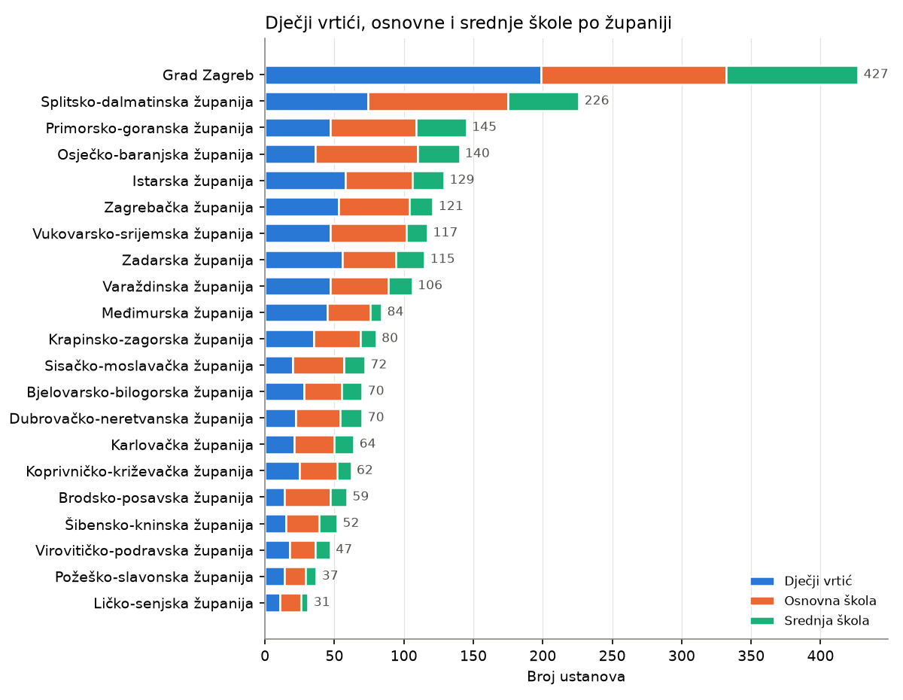

# EDA – Registers of educational institutions (`Data/obrazovne_ustanove`)

Every number in this document is copied from the output of the scripts below, run in the `datathon` conda env. Where something could not be determined from the data, it is marked as an **open question** rather than explained.

**Personal data.** The files contain names of principals and heads, e-mail addresses, phone and fax numbers, and some founders who are private persons. This report only says how complete those columns are; it does not reproduce names or contact details. Those columns are also left out of the processed register.

| Script | What it does |
|---|---|
| `14_inspect_ustanove.py` | Raw structure of the four CSV files: per column, fill count, distinct values, whitespace problems and top values (personal columns without values) |
| `15_eda_ustanove.py` | Cleaning, counts by register / county / place / type / founder, code-structure checks, overlap between files, completeness, combined register and chart |
| `16_verify_ustanove.py` | Bug check: recomputes the report's numbers independently (raw CSVs read with Python's `csv` module, no pandas) and compares them with the report; also checks the processed register against the raw files |

Charts are saved in `EDA/Reports/figures/obrazovne_ustanove/`.

---

## 1. The data files

| File | Content (as observed) | Shape |
|---|---|---|
| `djecji_vrtici.csv` | Kindergartens and other preschool-programme providers | 885 rows × 7 columns |
| `osnovne_skole.csv` | Primary schools | 926 rows × 13 columns |
| `srednje_skole.csv` | Secondary schools | 443 rows × 13 columns |
| `ustanove_visoko_obrazovanje.csv` | Higher-education institutions | 133 rows × 12 columns |

All four files are UTF-8, comma-separated, with quoted fields and a header row. No file contains fully duplicated rows. The files have no date or "as of" information, so **it is not known what date the registers describe** (open question).

### 1.1 Data quality notes (all four files)

- **Whitespace.** Leading or trailing spaces and repeated spaces occur in many columns. For example, 686 of 885 kindergarten county values have leading/trailing spaces, and *Vukovarsko-srijemska  županija* appears with a double space. All text was trimmed and repeated spaces collapsed before counting.
- **County names.** After the whitespace cleaning, the only remaining variant is *Grad Zagreb županija* (primary and secondary files) vs *Grad Zagreb* (kindergartens). It was harmonised to *Grad Zagreb*, which leaves exactly **21 county values**, the same set in all three files that have a county.
- **Header names are not consistent between files.** Some use diacritics and some don't (`ePosta` / `ePošta`, `Zupanija` / `Županija`, `PostanskiBroj` / `PoštanskiBroj`, `NadredjenaUstanova`).
- **The primary-school county column is labelled `Župnija`** (Croatian for "parish"), but its values are the 21 counties. It is treated as *Županija*.
- **Place names** are upper case in the higher-education file (`ZAGREB`) and mixed case elsewhere. They were converted to title case for comparisons.
- **Overlap between files.** 13 institutions appear in both the primary- and the secondary-school file: same *Šifra*, identical name. Their type is a combination such as *Osnovna škola, Srednja škola*. Counted per file they appear twice, so there are **1,356 distinct schools** (926 + 443 − 13).

---

## 2. Kindergartens (`djecji_vrtici.csv`)

### Columns and what they represent

| Column | Meaning | Filled | Observed values |
|---|---|---|---|
| `Naziv` | Name | 885 | e.g. *Dječji vrtić "Maslačak"*; 33 values with leading/trailing spaces |
| `Adresa` | Street address | 885 | |
| `Mjesto` | Place | 885 | 435 distinct places |
| `ePosta` | E-mail | 883 | *contact data, values not shown* |
| `Telefon` | Phone | 880 | *contact data, values not shown* |
| `Zupanija` | County | 885 | 21 counties after cleaning |
| `PostanskiBroj` | Postal code | 885 | all 5 digits |

The file has no institution code, type or founder column.

### Findings

- 885 rows in 435 places. The most common places are Zagreb (183), Zadar (25), Pula (23), Split (22), Varaždin (14) and Čakovec (14).
- **22.5% are in Grad Zagreb** (199 rows), the highest share of the three school-level registers.
- **Not all rows are kindergartens by name.** 274 of 885 names don't start with *Dječji vrtić*. The most common first words are *Program predškolskog …* (35), *Program predškole …* (31), *Kraći program …* (13), *Udruga za …* (11), *Udruga društvo …* (8), *Društvo sportske …* (7) and *Talijanski dječji …* (4). So the file also lists providers of preschool programmes, associations and sports societies, not only kindergartens.
- **Names are reused.** There are 780 distinct names (case-insensitive) across 885 rows. 55 names are used by more than one row (160 rows), e.g. *Dječji vrtić "Maslačak"* 10× and *"Radost"* 9×. No two rows share the same name *and* place, so these are different institutions with the same name.

---

## 3. Primary schools (`osnovne_skole.csv`)

### Columns and what they represent

| Column | Meaning | Filled | Observed values |
|---|---|---|---|
| `Web` | Website | 559 | 4 junk values: 3× `,` and 1× `1,` |
| `Faks` | Fax | 751 | *contact data, values not shown* |
| `Naziv` | Name | 926 | upper and mixed case (e.g. *OSNOVNA ŠKOLA VLADIMIRA NAZORA* / *Osnovna škola Vladimira Nazora*) |
| `Adresa` | Street address | 924 | |
| `Mjesto` | Place | 926 | 577 distinct places |
| `Šifra` | Institution code | 926 | unique; format `NN-NNN-NNN` (1 exception, see below) |
| `Telefon` | Phone | 916 | *contact data, values not shown* |
| `ePošta` | E-mail | 924 | *contact data, values not shown* |
| `Osnivač` | Founder | 926 | 88 distinct |
| `Župnija` | **County** (header says "parish") | 926 | 21 counties |
| `Ravnatelj` | Principal | 910 | *personal data, values not shown* |
| `TipUstanove` | Type of institution | 926 | one or more types separated by `, ` |
| `PoštanskiBroj` | Postal code | 926 | all 5 digits |

### Findings

- 926 schools in 577 places: Zagreb 117, Split 28, Rijeka 28, Osijek 19, Zadar 11 and Pula 11. 14.4% are in Grad Zagreb.
- **Type.** 874 are only *Osnovna škola*. The others combine types: *Umjetnička škola* 37, *Posebna ustanova odgoja i obrazovanja* 10, *Srednja škola* 13 and *Obrazovanje odraslih* 1, counted after splitting the combinations.
- **Founder** (classified by words in the name):

  | Founder | Schools |
  |---|---:|
  | a county (*… županija*) | 534 |
  | a town (*Grad …*) | 352 |
  | a municipality (*Općina …*) | 1 |
  | other founders | 39 |

  The 39 others are 12 ministries, 10 religious bodies, 7 associations, 5 companies or private schools, and 5 with no keyword (incl. private persons). This keyword classification is approximate.
- **Names.** 835 distinct names (case-insensitive) across 926 rows. 53 names are shared by several schools (e.g. *Osnovna škola Vladimir Nazor* 6×), always in different places.

---

## 4. Secondary schools (`srednje_skole.csv`)

### Columns and what they represent

The same 13 columns as the primary-school file, except that the county column is correctly named `Županija` and it is in a different position.

| Column | Meaning | Filled |
|---|---|---|
| `Web` | Website | 302 |
| `Faks` | Fax (*contact data*) | 298 |
| `Naziv` | Name | 443 |
| `Adresa` | Street address | 443 |
| `Mjesto` | Place (117 distinct) | 443 |
| `Šifra` | Institution code (unique, `NN-NNN-NNN`) | 443 |
| `Telefon` | Phone (*contact data*) | 431 |
| `ePošta` | E-mail (*contact data*) | 442 |
| `Osnivač` | Founder (88 distinct) | 443 |
| `Ravnatelj` | Principal (*personal data*) | 429 |
| `Županija` | County (21) | 443 |
| `TipUstanove` | Type(s) of institution | 443 |
| `PoštanskiBroj` | Postal code (all 5 digits) | 443 |

### Findings

- 443 schools in only 117 places: Zagreb 93, Split 28, Rijeka 23, Osijek 19 and Zadar 16. 21.4% are in Grad Zagreb.
- **Type.** 380 are only *Srednja škola*. 47 are also *Umjetnička škola*, 50 also *Osnovna škola*, 9 also *Posebna ustanova* and 1 also *Obrazovanje odraslih*.
- **Founder.**

  | Founder | Schools |
  |---|---:|
  | a county | 301 |
  | a town | 79 |
  | other founders | 63 |

  The 63 others are 12 ministries, 16 religious bodies, 3 associations, 8 companies or private schools, and 24 with no keyword (incl. private persons). Compared with primary schools, a much larger share of secondary schools is founded by counties: 68% vs 58%.
- The ministry most often named as founder in both files together is *Ministarstvo za demografiju, obitelj, mlade i socijalnu skrb* (21 schools).
- Of the schools in county Grad Zagreb (both files), 180 have *Grad Zagreb* as founder and 48 have another founder. No school outside Grad Zagreb has *Grad Zagreb* as its founder.

### Institution code `Šifra` (primary and secondary)

- 1,368 of 1,369 codes have the format `NN-NNN-NNN`. The exception is `14-060-24` (*Waldorfska škola u Osijeku*).
- **The first two digits correspond to the county.** 20 of the 21 prefixes map to exactly one county. The exception is prefix **02**: 45 schools in Krapinsko-zagorska and 1 in Grad Zagreb. All 227 schools with prefix **21** are in Grad Zagreb. *Open question:* whether the one Grad Zagreb school with prefix 02 is an error.
- The last part of the code runs from 1 to 632 for primary schools and from 2 to 636 for secondary schools. The data doesn't show what it means (open question).

---

## 5. Higher-education institutions (`ustanove_visoko_obrazovanje.csv`)

### Columns and what they represent

| Column | Meaning | Filled | Observed values |
|---|---|---|---|
| `URL` | Website | 133 | `www.uniri.hr` and `www.vern.hr` are each used by 2 institutions |
| `mbu` | Institution number | 133 | unique, numeric, 6–368 |
| `Faks` | Fax | 132 | *contact data* |
| `Adresa` | Street address | 133 | 93 values padded with trailing spaces |
| `Celnik` | Head of institution | 133 | *personal data* |
| `Mjesto` | Place | 133 | upper case; 28 places |
| `ePosta` | E-mail | 133 | *contact data* |
| `Telefon` | Phone | 133 | *contact data* |
| `Upisnik` | Register entry | 133 | *Znanstvena ustanova i visoko učilište* (94) / *Visoko učilište* (39) |
| `NazivUstanove` | Name | 133 | unique |
| `VrstaUstanove` | Type | 133 | 6 types |
| `NadredjenaUstanova` | Parent institution | 83 | one of the 4 public universities |

There is **no county or postal-code column**, so higher education isn't included in the county analysis.

### Findings

| Type | Total | Visoko učilište | Znanstvena ustanova i visoko učilište |
|---|---:|---:|---:|
| Fakultet | 65 | 3 | 62 |
| Visoka škola | 20 | 14 | 6 |
| Veleučilište | 17 | 14 | 3 |
| Sveučilište | 13 | 2 | 11 |
| Sveučilišni odjel | 12 | 4 | 8 |
| Umjetnička akademija | 6 | 2 | 4 |
| **Total** | **133** | **39** | **94** |

- **Parent institution.**
  - All faculties, university departments and art academies (83) have one: Sveučilište u Zagrebu 34, J. J. Strossmayer u Osijeku 17, u Splitu 16, u Rijeci 16.
  - Universities, polytechnics (*veleučilišta*) and colleges (*visoke škole*) have none (50).
- **Places.** Zagreb 50, Split 19, Rijeka 18, Osijek 18, Pula 3, Dubrovnik 2, Varaždin 2, plus 21 places with one institution each.

---

## 6. Institutions per county (kindergartens, primary and secondary schools)

| County | Kindergartens | Primary | Secondary | Total |
|---|---:|---:|---:|---:|
| Grad Zagreb | 199 | 133 | 95 | 427 |
| Splitsko-dalmatinska | 74 | 101 | 51 | 226 |
| Primorsko-goranska | 47 | 62 | 36 | 145 |
| Osječko-baranjska | 36 | 74 | 30 | 140 |
| Istarska | 58 | 48 | 23 | 129 |
| Zagrebačka | 53 | 51 | 17 | 121 |
| Vukovarsko-srijemska | 47 | 55 | 15 | 117 |
| Zadarska | 56 | 38 | 21 | 115 |
| Varaždinska | 47 | 42 | 17 | 106 |
| Međimurska | 45 | 31 | 8 | 84 |
| Krapinsko-zagorska | 35 | 34 | 11 | 80 |
| Sisačko-moslavačka | 20 | 37 | 15 | 72 |
| Bjelovarsko-bilogorska | 28 | 27 | 15 | 70 |
| Dubrovačko-neretvanska | 22 | 32 | 16 | 70 |
| Karlovačka | 21 | 29 | 14 | 64 |
| Koprivničko-križevačka | 25 | 27 | 10 | 62 |
| Brodsko-posavska | 14 | 33 | 12 | 59 |
| Šibensko-kninska | 15 | 24 | 13 | 52 |
| Virovitičko-podravska | 18 | 18 | 11 | 47 |
| Požeško-slavonska | 14 | 15 | 8 | 37 |
| Ličko-senjska | 11 | 15 | 5 | 31 |

The 13 schools listed in both the primary and the secondary file are counted in both columns.

- **The county mix differs.**
  - In 8 counties kindergarten rows outnumber primary schools: Grad Zagreb, Istarska, Zadarska, Međimurska, Varaždinska, Zagrebačka, Krapinsko-zagorska and Bjelovarsko-bilogorska.
  - In Virovitičko-podravska they are equal (18 each).
  - In Osječko-baranjska (74 vs 36) and Brodsko-posavska (33 vs 14) there are more than twice as many primary schools as kindergarten rows.
- *Open question:* whether this reflects real differences in provision or differences in how the kindergarten register was compiled. Programme providers and associations are included (see section 2), and the files contain no population or child counts to normalise by.

---

## 7. Completeness of columns

| Column | Kindergartens | Primary | Secondary | Higher ed. |
|---|---|---|---|---|
| Name, place | 885/885 | 926/926 | 443/443 | 133/133 |
| Address | 885/885 | 924/926 | 443/443 | 133/133 |
| Postal code, county | 885/885 | 926/926 | 443/443 | – |
| Code / founder / type | – | 926/926 | 443/443 | type 133/133 |
| Website | – | 559/926 | 302/443 | 133/133 |
| E-mail | 883/885 | 924/926 | 442/443 | 133/133 |
| Phone | 880/885 | 916/926 | 431/443 | 133/133 |
| Fax | – | 751/926 | 298/443 | 132/133 |
| Principal / head | – | 910/926 | 429/443 | 133/133 |
| Parent institution | – | – | – | 83/133 |

Identifying and location fields are essentially complete. **Websites are the weakest field for schools:** 60% filled for primary and 68% for secondary schools. 4 of the filled primary-school values are junk (3× `,`, 1× `1,`); the secondary-school file has none.

---

### Processed dataset: `Data/processed/ustanove_registar.csv`

**What it is:** the four registers combined into **one table with one row per register entry** (2,387 rows = 885 + 926 + 443 + 133), with harmonised Croatian column names. It is created by `15_eda_ustanove.py`. The 13 schools listed in both school files appear twice, once per register; use *Šifra ustanove* to de-duplicate.

**Column headers are in Croatian.** The CSV is UTF-8 with BOM, so Excel shows č, ć, š, ž and đ correctly.

**How it was built:**

1. Each file is read with every value as text, and only empty cells count as missing.
2. The source columns are mapped to common names. *Župnija* (primary schools) becomes *Županija*; *NazivUstanove* and *VrstaUstanove* (higher education) become *Naziv* and *Tip ustanove*.
3. In every column, leading and trailing spaces are removed and repeated spaces collapsed.
4. *Grad Zagreb županija* becomes *Grad Zagreb*.
5. Place names in the higher-education rows are converted to title case.
6. **Personal and contact columns are not written:** principal/head, e-mail, phone and fax.

**Deliberately NOT changed:**

- names are not corrected or merged;
- the 4 junk website values (`,` / `1,`) are kept as they are;
- the founder text is kept as given, including private persons named as founders in the source.

**Columns:**

| Column | Meaning | Filled for |
|---|---|---|
| `Vrsta registra` | Which file the row comes from: *Dječji vrtić*, *Osnovna škola*, *Srednja škola*, *Visoko učilište* | all |
| `Naziv` | Name | all |
| `Adresa` | Street address | all except 2 primary schools |
| `Mjesto` | Place | all |
| `Poštanski broj` | Postal code | kindergartens, primary, secondary |
| `Županija` | County (harmonised, 21 values) | kindergartens, primary, secondary |
| `Šifra ustanove` | Institution code | primary, secondary |
| `MBU` | Institution number (*mbu*) | higher education |
| `Osnivač` | Founder | primary, secondary |
| `Tip ustanove` | Type(s) of institution (*TipUstanove* / *VrstaUstanove*) | primary, secondary, higher education |
| `Upisnik` | Register entry | higher education |
| `Nadređena ustanova` | Parent university | 83 higher-education rows |
| `Web` | Website | partly (see section 7) |

---

## 8. Summary

1. The four registers list **885 kindergarten/preschool entries, 926 primary schools, 443 secondary schools and 133 higher-education institutions**. There are 1,356 distinct schools, because 13 appear in both school files.
2. **Grad Zagreb** has 427 kindergarten and school entries (18.9%). Its share is highest for kindergartens (22.5%) and lowest for primary schools (14.4%).
3. **Counties found most primary and secondary schools** (534 and 301), followed by towns (352 and 79). Ministries, religious bodies, associations, companies and private persons found 102 schools in total.
4. **Higher education** is concentrated in the four university cities: Zagreb 50, Split 19, Rijeka 18 and Osijek 18, i.e. 105 of 133. Faculties make up 65 of the 133 institutions.
5. **Data quality** needs light cleaning but is good overall:
   - whitespace and county-name variants;
   - a mislabelled `Župnija` header;
   - 1 malformed code and 1 code-prefix exception;
   - 4 junk website values;
   - a kindergarten file that also includes programme providers and associations.

### Open questions (not answerable from these files)

- What date the registers describe.
- Whether the one Grad Zagreb school with code prefix 02 and the code `14-060-24` are errors.
- What the last part of *Šifra* means.
- Whether the county differences in kindergarten counts reflect provision or how the register was compiled.
